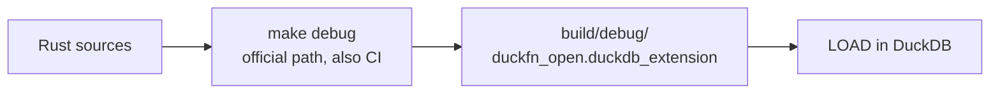
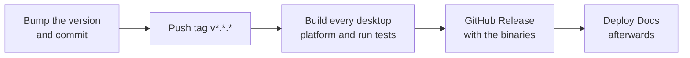

# Build and release

## Build

The official DuckDB `extension-ci-tools` makefiles are the one path, and `just build` wraps it:

```shell
make configure           # once: builds configure/venv (Python + the sqllogictest runner)
make debug               # the official path, also what CI runs
# -> build/debug/duckfn_open.duckdb_extension
```

Where the artifact lands and how it is loaded:



`just build` runs `make configure && make debug`. `make release` is the optimized version of the same
flow. On Windows `make` has to run inside Git Bash.

## Justfile

| Command | What it does |
| --- | --- |
| `just build` | `make configure && make debug` |
| `just sql "SELECT open_path(NULL)"` | Build, then run one statement and exit |
| `just repl` | A DuckDB REPL with the extension loaded |
| `just lint` | `cargo clippy --all-targets -- -D warnings` |
| `just test` | The official build and the sqllogictest run |
| `just docs_csv` | Export the function descriptions to `target/function_descriptions.csv` |
| `just docs_build` / `just docs_start` | Build / serve this documentation site |
| `just rename <name>` | Rewrite the extension name everywhere |
| `just release_*` | The release flow below |
| `just build_wasm` / `build_wasm_eh` / `test_wasm` | Local overrides: they print one line saying this extension has no wasm build (see [No WebAssembly build](#no-webassembly-build)) |
| `just sync-common` / `just check-common` | Update / verify `scripts/common.just` (below) |

Every recipe here lives in `scripts/common.just` — a file shared by every extension project and imported
by the root `Justfile` (`just --list` shows the merged set). Its source of truth is the duckfn
repository: `just sync-common` pulls the latest copy, `just check-common` reports when this one differs.
Put project-specific commands in the root `Justfile` rather than editing the copy; see `AGENTS.md`.

That is exactly how the wasm recipes got turned off: the shared copy still defines `build_wasm`,
`build_wasm_eh` and `test_wasm`, and the root `Justfile` re-declares all three (under
`set allow-duplicate-recipes := true`) to call one private `no_wasm` recipe. Editing the copy instead
would lose the change on the next `just sync-common`.

:::note[Two stale comments in the shared copy]

`just --list` prints the comments that come with `scripts/common.just`, and two of them still describe the
template's wasm setup: `docs_build` / `docs_start` say the build needs the extension under
`docs/static/duckdb-extensions/`, and `config_env` adds the `wasm32-unknown-emscripten` target. Neither
applies here — the site has no runnable blocks and nothing to preload, and `config_env`'s useful half is
its `rustup override set`. Those comments are deliberately not edited away.

:::

## Release flow

A release is four steps, and only the second one is manual:

| Step | Command |
| --- | --- |
| 0. Pre-flight | `just release_check` (clippy + build); `just test` when the change warrants it |
| 1. Bump the version | `just release_bump {{EXTENSION_VERSION}}` |
| 2. Commit and tag | `git commit …` then `just release_tag {{EXTENSION_VERSION}}` |
| 3. Watch CI | `just release_ci`, then `gh run watch <run-id>` |
| 4. Next development version | `just release_dev 0.1.1-dev.0` |

The version lives in `Cargo.toml` (`[package] version`) and nowhere else:
`scripts/release.sh bump` rewrites that one line, updates the occurrences in the docs and the CI
comments, syncs `Cargo.lock` and fixes `docs/extension-version.ts`, which is where the documentation
site gets the version number it prints. The tag has to match `Cargo.toml`, because cargo writes the
version into the built extension — a mismatch would publish a release claiming another version.

Only real releases get a tag. A version like `0.1.1-dev.0` stays on the branch: no tag, no release, no
site deployment.

### What a tag triggers

Pushing `v*.*.*` starts **Main Extension Distribution Pipeline**:



- **Main Extension Distribution Pipeline** — builds the extension for every supported desktop platform
  (the wasm architectures are excluded through the workflow's `exclude_archs` input — see
  [No WebAssembly build](#no-webassembly-build)), runs the tests, then creates (or updates) a GitHub
  Release for that tag with the built binaries attached as `<extension>-<arch>.duckdb_extension`. Release
  notes are the commits since the previous version tag.
- **Deploy Docs** is not started by the tag but by that pipeline *finishing*: it builds `docs/` and
  publishes it to GitHub Pages. The site is a static one — it fetches nothing from the release (its `sql`
  fences are code blocks, not live examples). It needs the one-time *Settings → Pages → Source: GitHub
  Actions* setting.

Pull requests run the build and the tests only; publishing is gated on the ref being a version tag.

### Installing a release

```sql
LOAD 'https://github.com/<owner>/<repo>/releases/latest/download/duckfn_open-windows_amd64.duckdb_extension';
```

A locally built extension needs `duckdb -unsigned`; a released one that a user downloads also has to be
loaded with that flag, because it is not signed by DuckDB's distribution key. That is what the
[community-extension](./community-extension.md) route fixes: once registered, `INSTALL … FROM community`
fetches a signed build for the user's platform.

## No WebAssembly build

This project does not build for wasm, and that is a design decision rather than a missing step: a launcher
is desktop software — there is no desktop to hand a file to inside a browser — and
[`open`](https://crates.io/crates/open) has no emscripten implementation, writing `compile_error!` on that
target, so a wasm build would not even reach the linker.

The exclusion is done all the way through, and each landing point is deliberate:

| Where | What it looks like now |
| --- | --- |
| `Cargo.toml` | No wasm `[[example]]` (the template's `staticlib` forward is gone), and `open` is an ordinary `[dependencies]` entry with no `[target.'cfg(…)'.dependencies]` gate. |
| `src/` | One crate root, `src/lib.rs` (the template's `src/wasm_lib.rs` is deleted), and no `#[cfg(target_arch = "wasm32")]` stand-ins in `src/extension/launcher.rs`. |
| `.github/workflows/MainDistributionPipeline.yml` | `exclude_archs: 'wasm_mvp;wasm_eh;wasm_threads'`, so the Release carries native-platform assets only. |
| `Justfile` | `build_wasm`, `build_wasm_eh` and `test_wasm` are overridden to print one line; the shared copy in `scripts/common.just` keeps its originals and is not edited. |
| `docs/` | No runnable SQL blocks: every `sql` fence is a static code block, so the examples run in a local DuckDB after a `LOAD` (see [Quick start](./quick-start.md)). |

Restoring wasm would mean redoing all five rows at once, not flipping one switch — so when you add a
dependency, do not budget for a wasm target and do not reach for a `[[example]]` staticlib.

The `.cargo/config.toml` of a project that *does* build wasm needs `-sSIDE_MODULE=2` under
`[target.wasm32-unknown-emscripten] rustflags` (a `cdylib` there has to link as a side module). This
repository carries no such entry, only the Windows `crt-static` one: it has no emscripten target to link.
