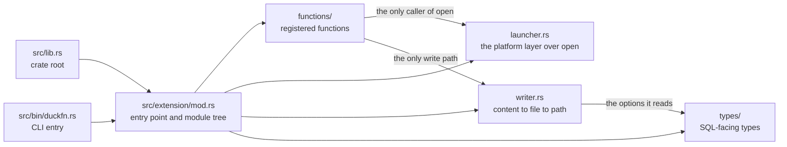

# Project structure

## Written with duckfn

Every function this extension registers is an ordinary Rust function carrying a [duckfn](https://crates.io/crates/duckfn)
attribute macro; the macro writes the registration and the argument reading. No C++ takes part in the build, and
the C API is used headers-only, through DuckDB's API function table (`libduckdb-sys` with `loadable-extension`),
which is what keeps a local DuckDB build out of the loop — see [build and
release](./build-and-release.md).

The repository started from [duckfn-extension-template](https://github.com/shijianjs/duckfn-extension-template),
which carries the working loop — build, SQLLogicTest, docs export, release. Another extension written the same
way is [duckfn_quantstats](https://github.com/shijianjs/duckfn-quantstats). What follows is what this
repository made of that template:

```text
src/lib.rs             crate root  ->  mod extension;
src/extension/mod.rs   ->  duckfn_entrypoint!("duckfn_open");
                           mod functions; mod launcher; mod types; mod writer;
src/bin/duckfn.rs      duckfn CLI entry   ->  #[path] mod extension; + duckfn::cli::run(...)

src/extension/functions/
    mod.rs                  one `mod …;` per file below, alphabetical (grouped by family here)
    scalar_op_open_path.rs     op_open_path / op_open_path_detached, two signatures each
    scalar_op_open_commands.rs op_open_commands        (VARCHAR -> VARCHAR[], starts no process)
    scalar_op_write_file.rs    op_write_file           four signatures, writes only
    scalar_op_open_content.rs  op_open_content         four signatures, write and then open
    scalar_op_open_html.rs     op_open_html            the zero-configuration HTML shortcut
    scalar_op_print.rs    op_print           two signatures, straight to stdout
    scalar_op_sanitize_filename.rs op_sanitize_filename / op_sanitize_filename_check, five signatures, pure strings
src/extension/launcher.rs   the platform layer over the `open` crate (the only file that calls it)
src/extension/writer.rs     content -> file -> path: extension, directory, naming, legality
src/extension/types/
    mod.rs                  the SQL-facing types layer
    op_write_file_options.rs   the registered STRUCT type `op_write_file_options`

test/sql/                   duckfn_open.test (smoke) + one .test per function file
scripts/rename.sh           rename the extension after cloning
scripts/release.sh          version bump, tag, development version
Justfile                    the everyday commands
docs/                       this documentation site
community-extension/        the community-extension registration draft
```

## One crate root

`src/lib.rs` declares exactly one module, `mod extension;`, and `extension/mod.rs` attaches the other four
below it: `functions`, `launcher`, `types`, `writer`. The official Rust template instead writes `mod lib;`
and forwards it a second time from another crate root, which breaks as soon as modules nest (`error[E0583]:
file not found for module …`): there would be two copies of the same path set to keep in sync.

Two entry points compile the same module tree — the crate root and the CLI:



Adding a module therefore means editing `extension/mod.rs` (and the `mod.rs` of the layer below), never
the crate root.

## What each layer owns

Everything under `extension/` except the entry point is one of four layers, and the split is by *what a
change to it would cost*:

| Layer | Owns | Deliberately does not |
| --- | --- | --- |
| `functions/` | the SQL boundary: check the arguments, prefix errors with the function name, pick the one launcher or writer call | build a command line, or decide how a file name is put together |
| `launcher.rs` | everything platform-specific about starting a program | reach back into SQL types beyond duckfn's own |
| `writer.rs` | content → file → path: the extension, the directory, the generated name, file-name legality | start a process |
| `types/` | the shape of the SQL-facing types | validate anything |

So a signature that grows an argument, a platform that grows a launcher, and a naming rule that grows an
exception each land in exactly one file.

One file is the exception to the `functions/` row: `scalar_op_sanitize_filename.rs` has no process to start and no
file to write, so the SQL boundary there *is* the whole function — it calls
[`sanitize-filename`](https://crates.io/crates/sanitize-filename) itself, wiring the crate's two entry points
(rewrite, and test) straight to SQL. That makes it a *sibling* of the two layers below, not a client of either
(see [the pure-string family](#the-pure-string-family)).

## The platform layer: `launcher.rs`

`extension/launcher.rs` is not in the template — this extension added it, and it is the only file that
touches the [`open`](https://crates.io/crates/open) crate. Its whole surface is seven functions in three
groups:

1. four actions that squash `io::Result<()>` into a `bool` (default/chosen program × waiting/non-blocking),
   which is what the `op_open_path` family returns;
2. `open_default_checked`, the same non-blocking launch re-shaped as an error — see below;
3. `preview_commands`, which renders the `Vec<Command>` open would run as a list of strings, plus
   `check_not_empty`, the argument check the SQL boundary makes.

`open_default_checked` exists because `op_open_content` and `op_open_html` already spend their return value on
the path they wrote: a launch failure there has nowhere to go but an error, and that error carries the
path (the file *is* on disk; this machine just has no desktop to show it). Splitting it out of the bool
group is what keeps one rule — "the launcher's verdict becomes the return value, or an error, never both".

`check_not_empty` is what the five launch-path signatures (`op_open_path` × 4 and `op_open_commands`) make at the
SQL boundary, and it is one function instead of five copies so the message always reads the same way.
A path is never validated further than "not empty": deciding whether a string is a usable path or URL is
open's business, and this layer does not second-guess it.

Why a module and not one inlined call per signature: the function files never deal with open's types, and
everything open already owns (the per-platform entry points, argument quoting, the WSL and Wine branches)
stays in one place instead of being re-decided per call site.

So a new function that needs the launcher calls `launcher::…` instead of `use open::`, and the SQL layer
stays free of platform code — there is no `#[cfg]` anywhere in this tree: the extension builds for desktop
targets only (see [build and release](./build-and-release.md)).

## The persistence layer: `writer.rs`

The launcher understands paths, not content, while what a query holds is usually content: a rendered HTML
or SVG, a CSV, the PNG bytes of a BLOB. `writer.rs` is that missing step — content → file → path — and it
has exactly one entry point, `write(bytes, extension, options)`.

Why it is a layer of its own rather than a helper inside one function file: `op_write_file`, `op_open_content`
and `op_open_html` all go through that single `writer::write`, so the rules below exist once and apply to all
three. A fourth name that writes files gets them for free.

What lives there:

- **The extension** — required, and normalised (`html`, `.html`, ` HTM ` all become `.html`). An empty one
  is an error, and so is one carrying a path separator, which is a path in disguise.
- **The directory** — `dir` when given, the system temp directory otherwise, created with its parents
  either way.
- **The name** — the caller's `name` when given (an existing file of that name is overwritten), otherwise
  `open-<time>-<part>-<random>.<extension>`. The timestamp is `chrono`'s, the random suffix and the
  "this name was free at that moment" guarantee are `tempfile`'s.
- **Legality** — all three caller-supplied fields go through `sanitize-filename`, so one set of rules
  covers the directory, the file name and the name segment.

Paths are joined with a literal `/` (`join(dir, file_name)`), never with `Path::join`, which follows the
platform separator. One shape on every platform is what makes the return value usable: it is printed into a
terminal, it is usually concatenated further by a downstream query, and the tests assert it as
`__TEST_DIR__/name.ext`. `std::fs` accepts `/` on Windows too, so nothing downstream has to know.

Nothing in this file launches a process and nothing in it is gated on a target — same reason as the
platform layer: desktop only.

## The pure-string family

`scalar_op_sanitize_filename.rs` holds `op_sanitize_filename` (three signatures) and `op_sanitize_filename_check` (two). It sits
under `functions/` and calls *neither* layer: no process is started, no file is written, a `VARCHAR` goes in
and a `VARCHAR` or a `BOOLEAN` comes out. What it is instead — and what makes it a sibling of the two layers
rather than a client of either — is the [`sanitize-filename`](https://crates.io/crates/sanitize-filename)
crate's own surface wired straight to SQL.

The crate maintains *whether a string can be a file name*: the illegal characters `/ \ ? < > : * | "`, the
control characters, the all-dot names (`.` and `..`), the Windows reserved device names (`CON`, `PRN`, `AUX`,
`NUL`, `COM0-9`, `LPT0-9`, with or without a suffix), trailing dots and spaces, and the 255-**byte** cut.
`op_sanitize_filename`'s three trailing arguments are the crate's own `Options` fields and its defaults are the
crate's too, so illegal characters are **deleted** (`replacement` is the empty string — pass a substitution to
see where the edits were) and the cut is applied.

**One default does not follow the crate: `windows` is pinned to `true`.** Its default there is the *compiling
platform*, which would make one SQL statement answer differently on two machines; `true` is the strictest set
and the same on all three platforms. Pass `false` for that switch when you want the Unix rules — under them
`op_sanitize_filename('CON.txt', '_', true, false)` keeps the name, and `op_sanitize_filename_check('CON.txt')` still
answers `false`, because that call is asking about Windows.

These are **not helpers of `op_write_file`**, although the write family uses the same crate internally — with a
different policy: `op_write_file`'s `name` substitutes `_` and never truncates, while `op_sanitize_filename` deletes and
does. Two sets of defaults, documented separately, so neither is a stand-in for the other. That choice is what
the shape of the API records: `op_sanitize_filename` has **no three-argument form**, because `truncate` and `windows`
can only be passed together — the one compression in this API (two BOOLEANs in optional positions would be
five combinations, of which only the crate's two defaults deserve a shorter form); `op_sanitize_filename_check` takes
no `replacement`, because a question that rewrites nothing has nothing to substitute. It answers `true` exactly
when `op_sanitize_filename` under the same options would return the value unchanged, which is what makes
`WHERE NOT op_sanitize_filename_check(name)` an audit rather than a silent rewrite. A `NULL` in any argument makes
that row `NULL`.

Also deliberate: the auto-naming `part` rule inside `op_write_file` (spaces to `_`, capped at 48 characters) is
**not** exposed as a SQL name. That is this extension's own convention, not the crate's, and giving it a name
of its own would imply a rule callers can lean on outside the write path.

## SQL-facing types: `types/`

`extension/types/` holds the types that appear in SQL rather than in a Rust call. There is one today,
`op_write_file_options`, the STRUCT that carries the three optional settings of `op_write_file` / `op_open_content`
(`dir`, `name`, `part`):

```rust
#[derive(Clone, Debug, Default, DuckStruct)]
#[duck(sql_name = "op_write_file_options", create_type = "replace")]
pub(crate) struct OpenWriteOptions {
    pub dir: Option<String>,
    pub name: Option<String>,
    pub part: Option<String>,
}
```

Three things this shape is doing (the field-level ones are covered in [writing
functions](./writing-functions.md)):

- a STRUCT beats three optional positional arguments of the same type, and beats a JSON string too —
  a misspelled field fails at the binder instead of at run time;
- it keeps those names from spreading: the options are one argument, so `op_write_file` has exactly two
  arities instead of four;
- it deliberately holds **no** `app` field. Choosing the program is `op_open_path(path, app)`'s job, and
  handing that function the path is how this API composes.

Other things belong in this layer as well: a named type registered with `#[duck_enum]`, the row type of a
`list<struct<…>>` result, the options type a `DuckLazy` argument parses. Visibility goes one notch beyond
the file that reads it — `pub(crate)` here, because the `functions` subtree reads it.

And one thing deliberately does not: `op_sanitize_filename` / `op_sanitize_filename_check` register **no** type, which is
why `duckdb_types()` shows nothing new for them. Their options are two BOOLEANs that only make sense as a
pair — that is an argument list, not a shape worth a SQL type (see
[the pure-string family](#the-pure-string-family)).

## The command-line bin

`src/bin/duckfn.rs` compiles the extension a second time with `#[path = "../extension/mod.rs"] mod
extension;` and calls `duckfn::cli::run(...)`. It exists to export the function-description CSV
(`just docs_csv`) and takes no part in the extension itself.

The `#[path]` attribute is not a shortcut, it is necessary: the documentation metadata behind
`#[duck_*]` is collected by `inventory`'s static constructors, which only fire for object files that
are really linked into the final binary. With `use duckfn_open::…` the linker may drop those modules
and the exported CSV comes out empty — silently.

## One function per file, the prefix as a namespace

Files under `functions/` are named "kind + what it does": `scalar_op_open_path.rs` holds the two launcher
names (four signatures, because each name takes a `(path)` and a `(path, app)` form), `scalar_op_write_file.rs`
holds the four `op_write_file` signatures, `scalar_op_open_commands.rs` holds the read-only preview, and
`scalar_op_sanitize_filename.rs` holds the two pure-string names (five signatures) that reach neither layer. When a
feature outgrows a single file, split it into a subdirectory the way the duckfn example does
(`functions/<feature>/mod.rs` plus one file per concern).

Every registered name carries the same short prefix (`op_` here); the reasoning is in `AGENTS.md`:
community extensions almost never put the package name into function names, and a short prefix is enough
to search `duckdb_functions()` by. The prefix is a namespace, not an abbreviation of the extension name,
so it does not change when the extension is renamed. Below it there is one more level: the names that can
start a launcher say `op_open_` (`op_open_commands` included, since what it previews is those), and the
rest never say "open" — `op_write_file`, `op_print`, `op_sanitize_filename`.

## Dependencies

`Cargo.toml` carries a comment per crate saying what it is for and why it was picked. The choices that
shape the build are the **direct** ones — the attribute macros bring their own machinery along
(`duckfn-macro` expands them through `darling`, `syn`, `quote` and `proc-macro2`) and `quack-rs` brings
DuckDB's bindings, so `Cargo.lock` is longer than this list:

- **[duckfn](https://crates.io/crates/duckfn)** — the attribute macros that register ordinary Rust
  functions with DuckDB. Only the `cli` feature is on (it is what `src/bin/duckfn.rs` drives); `all` is
  avoided on purpose, because it also turns on `duckdb-1-5`, the **unstable region** of DuckDB's C API
  (copy functions, the host VFS, the scalar bind/init slots). Staying in the stable region is what makes
  one binary portable across DuckDB releases. The `chrono` / `uuid` / `rust_decimal` conversions are
  ABI-neutral and can be turned on when needed; `owned-connection` (which gates the host file system
  `duckfn::duck_vfs`) sits in the unstable region and is not needed.
- **[quack-rs](https://crates.io/crates/quack-rs)** — the DuckDB C API bindings the code expanded by
  `duckfn_entrypoint!` refers to directly.
- **[libduckdb-sys](https://crates.io/crates/libduckdb-sys)** — headers only (`loadable-extension`),
  which is what keeps a local DuckDB build unnecessary.
- **[open](https://crates.io/crates/open)** — the launching half of this extension: it already knows how to
  open a path or URL with whatever the desktop is configured to use, including the per-platform entry
  points, the argument quoting and the "no launcher could be started" error. It is an ordinary
  `[dependencies]` entry: this project builds for desktop targets only, so there is no target gate to
  write (see [build and release](./build-and-release.md)), and it is only ever called from
  `src/extension/launcher.rs` (the section above). The
  `shellexecute-on-windows` feature is on (the `_detached` group and `open_default_checked` then go through
  one `ShellExecuteW` call); `insecure`, which splices the path into a command line, is not.
- **[sanitize-filename](https://crates.io/crates/sanitize-filename)** — file-name legality: the illegal
  characters `/ \ ? < > : * | "`, control characters, Windows reserved device names (`CON`, `NUL`, `COM1`…)
  and trailing dots and spaces. The rules are its job; what we state is the policy, and there are **two**
  policies here. `writer.rs` substitutes `_`, does not truncate (it cuts at 255 *bytes*; length stays our
  business, in characters) and pins `windows: true`, so one set of rules holds on all three platforms.
  `scalar_op_sanitize_filename.rs` hands the crate's own surface to SQL — its defaults, deleted instead of
  substituted and the cut on — with `windows` pinned the same way, and it is explicitly *not* a helper of
  `op_write_file` (see [the pure-string family](#the-pure-string-family)).
- **[tempfile](https://crates.io/crates/tempfile)** — the random suffix of a generated name, the retry when
  one collides, and the guarantee that the name was free at that moment; also the scratch directories in
  `writer.rs`'s own tests. The alternative — roll a random number and poll `Path::exists` — leaves a TOCTOU
  window and needs its own random source.
- **[chrono](https://crates.io/crates/chrono)** — the `%Y%m%d-%H%M%S` timestamp inside a generated name.
  Calendar arithmetic is exactly what it is for; hand-rolling epoch math is not.

The last three serve the other half of the same story as `open`: a launcher wants a path, so content needs
somewhere to become one. That is the repository's standing rule — a general problem goes to a mature crate,
and hand-written code is for this extension's domain logic (the "不要自己造轮子" section of `AGENTS.md`).

Note that `chrono` here is plain Rust-side use (a timestamp in a file name), which is not duckfn's
`chrono` *feature*: that one is about converting `DuckDate` / `DuckTimestamp` to and from chrono's types,
and no function in this extension does that. If you add one, turn the feature on and add nothing else —
the crate is already a dependency. A `[target.'cfg(…)'.dependencies]` table is still the right tool for a
crate only *some* of your targets can compile; this project has no second target family, so it never needs
one.

## What this repository does not use

The template demonstrates the **registration paths** and the **engineering loop**. This extension registers
scalar functions and one STRUCT type, and the following are still not in it — write them from duckfn's docs
and example extension rather than from memory:

- aggregates (nothing here folds a group: no `#[duck_aggregate_function]`, no state type);
- table functions / `COPY` / casts / replacement scans / SQL macros (one attribute macro each; see
  duckfn's `docs/docs/guide/` and its example extension under `src/extension/`);
- named ENUM types (`#[duck_enum]`) — the same `create_type` idea as this extension's STRUCT, for a type
  whose values are a label dictionary;
- `DuckLazy<T>` arguments ("parse the options once") and `list<struct<…>>` results — the options STRUCT
  here is read as an ordinary argument, and the one list this extension returns is a plain `Vec<String>`;
- DuckDB's host file system (`duckfn::duck_vfs`; enable `owned-connection` explicitly) and the
  chrono / uuid / rust_decimal **bridges** (chrono itself is a dependency, as described above).

Three things the template did **not** have and this repository added are worth copying as patterns:
`overloads_name`, which folds several signatures under one SQL name (see
[writing functions](./writing-functions.md)), the platform layer (`launcher.rs`), which keeps a third-party
crate behind one shape instead of spreading its types through the SQL files, and the persistence layer
(`writer.rs`), which keeps one write path behind several SQL names.

## Naming rules

| Rule | Why |
| --- | --- |
| The extension name is lowercase with underscores, and identical in five places. | It is the entry-point symbol and the artifact file name; DuckDB looks the symbol up by the file name. `just rename` writes all five. |
| Every registered SQL name carries one short prefix (`op_` here). | DuckDB has no namespaces, and community extensions almost never put the package name into function names. See the conventions in `AGENTS.md`. |
| Temporary files (scripts, data, logs) go to `target/`. | `target/` is git-ignored and never pollutes the tracked tree. |
| Text files use LF. | The repository stores LF; the `.gitattributes` normalization relies on it. |

## Where the development notes are

The design notes live in this guide: the module layout above, [writing
functions](./writing-functions.md), [testing](./testing.md) and [build and
release](./build-and-release.md). The SQL side of the same API — what each name answers, with examples to
run — is in the user guide's [function overview](../user-guide/functions/overview.md). `AGENTS.md` holds the repository's
conventions, the release flow and a topic-by-topic map of duckfn's own documentation — everything the
attribute macros can do lives there, not in this repository.

Since duckfn 0.0.11 that documentation, plus a runnable example extension and its SQLLogicTest files,
ship **inside the crate package**, so they always match the version in `Cargo.toml` and need no clone of
the duckfn repository:

```shell
# after any build: the sources cargo actually compiled against
ls -d ~/.cargo/registry/src/*/duckfn-*/
```

| Path under that directory | What it is |
| --- | --- |
| `docs/docs/**` | The user guide's text (English), including the chapter per registration kind. |
| `docs/i18n/zh-Hans/…/current/**` | The same guide in Simplified Chinese. |
| `src/extension/**` | The example extension: one file per registration kind, plus custom types and a combined demo. |
| `test/sql/**` | SQLLogicTest files for the example, worth copying the structure of. |

The rendered guide is also online — [shijianjs.github.io/duckfn](https://shijianjs.github.io/duckfn/) —
but it may be newer than your dependency; the copy in the registry is what this project is compiled
against. The attribute macros' exact accepted arguments and return shapes live one step further down, in
`duckfn-macro-<version>/src/**` in the same registry directory.
