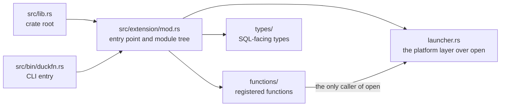

# Project structure

```text
src/lib.rs             crate root  ->  mod extension;
src/extension/mod.rs   ->  duckfn_entrypoint!("duckfn_open"); + mod functions; mod launcher; mod types;
src/bin/duckfn.rs      duckfn CLI entry   ->  #[path] mod extension; + duckfn::cli::run(...)

src/extension/functions/
    mod.rs             mod scalar_open_commands; mod scalar_open_path;
    scalar_open_path.rs     open_path / open_path_detached, two signatures each
    scalar_open_commands.rs open_commands        (VARCHAR -> VARCHAR[], starts no process)
src/extension/launcher.rs   the platform layer over the `open` crate (the only file that calls it)
src/extension/types/
    mod.rs             an empty slot: SQL-facing types go here

test/sql/                   duckfn_open.test (smoke) + one .test per function file
scripts/rename.sh           rename the extension after cloning
scripts/release.sh          version bump, tag, development version
Justfile                    the everyday commands
docs/                       this documentation site
community-extension/        the community-extension registration draft
```

## One crate root

`src/lib.rs` declares exactly one module, `mod extension;`, and `extension/mod.rs` attaches everything
else. The official Rust template instead writes `mod lib;` and forwards it a second time from another
crate root, which breaks as soon as modules nest (`error[E0583]: file not found for module …`): there
would be two copies of the same path set to keep in sync.

Two entry points compile the same module tree — the crate root and the CLI:



Adding a module therefore means editing `extension/mod.rs` (and the `mod.rs` of the layer below), never
the crate root.

## The platform layer: `launcher.rs`

`extension/launcher.rs` is not in the template — this extension added it, and it is the only file that
touches the [`open`](https://crates.io/crates/open) crate. Two jobs, each one line thin:

1. squash `io::Result<()>` into a `bool`, which is what SQL returns;
2. hand `&str` to open (it wants `OsStr` plus an app name) and render the `Vec<Command>` it would run as
   a list of strings.

The module also holds `check_not_empty`, the empty-argument check all five signatures make at the SQL
boundary.

Why a module and not five inlined calls: the five signatures share one shape — four actions returning a
bool plus one fallible preview — so the function files never deal with open's types, and everything open
already owns (the per-platform entry points, argument quoting, the WSL and Wine branches) stays in one
place instead of being re-decided per call site.

So a new function that needs the launcher calls `launcher::…` instead of `use open::`, and the SQL layer
stays free of platform code — there is no `#[cfg]` anywhere in this tree: the extension builds for desktop
targets only (see [build and release](./build-and-release.md)).

## The command-line bin

`src/bin/duckfn.rs` compiles the extension a second time with `#[path = "../extension/mod.rs"] mod
extension;` and calls `duckfn::cli::run(...)`. It exists to export the function-description CSV
(`just docs_csv`) and takes no part in the extension itself.

The `#[path]` attribute is not a shortcut, it is necessary: the documentation metadata behind
`#[duck_*]` is collected by `inventory`'s static constructors, which only fire for object files that
are really linked into the final binary. With `use duckfn_open::…` the linker may drop those modules
and the exported CSV comes out empty — silently.

## One function per file, the prefix as a namespace

Files under `functions/` are named "kind + what it does": `scalar_open_path.rs` holds the two launcher
names (four signatures, because each name takes a `(path)` and a `(path, app)` form), and
`scalar_open_commands.rs` holds the read-only preview. When a feature outgrows a single file, split it
into a subdirectory the way the duckfn example does (`functions/<feature>/mod.rs` plus one file per
concern).

Every registered name carries the same short prefix (`open_` here); the reasoning is in `AGENTS.md`:
community extensions almost never put the package name into function names, and a short prefix is enough
to search `duckdb_functions()` by.

## `types/` is a slot waiting for you

This extension speaks `VARCHAR`, `BOOLEAN` and `VARCHAR[]` to SQL and needs no custom type, so
`types/mod.rs` holds comments only. What goes in there are three kinds of thing:

- named types defined with `#[duck_struct]` / `#[duck_enum]` and registered into DuckDB at load time;
- the row type of a `list<struct<...>>` result (a plain Rust struct deriving `DuckStruct`);
- the options STRUCT a `DuckLazy` argument takes (parsed once inside the function).

Delete the whole directory if you never need it (and the `mod types;` line in `extension/mod.rs`).

## Dependencies

`Cargo.toml` carries a comment per crate saying what it is for and why it was picked. The choices that
shape the build:

- **[duckfn](https://crates.io/crates/duckfn)** — the attribute macros that register ordinary Rust
  functions with DuckDB. Only the `cli` feature is on (it is what `src/bin/duckfn.rs` drives); `all` is
  avoided on purpose, because it also turns on `duckdb-1-5`, the **unstable region** of DuckDB's C API
  (copy functions, the host VFS, the scalar bind/init slots). Staying in the stable region is what makes
  one binary portable across DuckDB releases. The `chrono` / `uuid` / `rust_decimal` conversions are
  ABI-neutral and can be turned on when needed; `owned-connection` (which gates the host file system
  `duckfn::duck_vfs`) sits in the unstable region and is not needed.
- **[quack-rs](https://crates.io/crates/quack-rs)** — the DuckDB C API bindings the code expanded by
  `duckfn_entrypoint!` refers to directly.
- **[libduckdb-sys](https://crates.io/crates/libduckdb-sys)** — headers only (`loadable-extension`),
  which is what keeps a local DuckDB build unnecessary.
- **[open](https://crates.io/crates/open)** — everything this extension wraps: it already knows how to
  open a path or URL with whatever the desktop is configured to use, including the per-platform entry
  points, the argument quoting and the "no launcher could be started" error. It is an ordinary
  `[dependencies]` entry: this project builds for desktop targets only, so there is no target gate to
  write (see [build and release](./build-and-release.md)), and it is only ever called from
  `src/extension/launcher.rs` (the section above). The
  `shellexecute-on-windows` feature is on (the `_detached` group then goes through one `ShellExecuteW`
  call); `insecure`, which splices the path into a command line, is not.

For anything date/time related, enable duckfn's `chrono` feature and add `chrono` as a dependency (duckfn
re-exports none of those crates); the two ready-made lines are at the bottom of `Cargo.toml`. A
`[target.'cfg(…)'.dependencies]` table is still the right tool for a crate only *some* of your targets can
compile — this project simply has no second target family, so it never needs one.

## What this repository does not use

The template demonstrates the **registration paths** and the **engineering loop**. This extension registers
scalar functions only, and the following are still not in it — write them from duckfn's docs and example
extension rather than from memory:

- aggregates (nothing here folds a group: no `#[duck_aggregate_function]`, no state type);
- table functions / `COPY` / casts / replacement scans / SQL macros (one attribute macro each; see
  duckfn's `docs/docs/guide/` and its example extension under `src/extension/`);
- `DuckLazy<T>` arguments ("parse the options once"), named types, `list<struct>` results — the one list
  this extension returns is a plain `Vec<String>`;
- DuckDB's host file system (`duckfn::duck_vfs`; enable `owned-connection` explicitly) and the
  chrono / uuid / rust_decimal bridges.

Two things the template did **not** have and this repository added are worth copying as patterns:
`overloads_name`, which merges the `(path)` and `(path, app)` signatures under each launcher name (see
[writing functions](./writing-functions.md)), and the platform layer itself (`launcher.rs`), which keeps a
third-party crate behind one shape instead of spreading its types through the SQL files.

## Naming rules

| Rule | Why |
| --- | --- |
| The extension name is lowercase with underscores, and identical in five places. | It is the entry-point symbol and the artifact file name; DuckDB looks the symbol up by the file name. `just rename` writes all five. |
| Every registered SQL name carries one short prefix (`open_` here). | DuckDB has no namespaces, and community extensions almost never put the package name into function names. See the conventions in `AGENTS.md`. |
| Temporary files (scripts, data, logs) go to `target/`. | `target/` is git-ignored and never pollutes the tracked tree. |
| Text files use LF. | The repository stores LF; the `.gitattributes` normalization relies on it. |

## Where the development notes are

The design notes live in this guide: the module layout above, [writing
functions](./writing-functions.md), [testing](./testing.md) and [build and
release](./build-and-release.md). `AGENTS.md` holds the repository's conventions, the release flow and a
topic-by-topic map of duckfn's own documentation — everything the attribute macros can do lives there,
not in this repository.

Since duckfn 0.0.11 that documentation, plus a runnable example extension and its SQLLogicTest files,
ship **inside the crate package**, so they always match the version in `Cargo.toml` and need no clone of
the duckfn repository:

```shell
# after any build: the sources cargo actually compiled against
ls -d ~/.cargo/registry/src/*/duckfn-*/
```

| Path under that directory | What it is |
| --- | --- |
| `docs/docs/**` | The user guide's text (English), including the chapter per registration kind. |
| `docs/i18n/zh-Hans/…/current/**` | The same guide in Simplified Chinese. |
| `src/extension/**` | The example extension: one file per registration kind, plus custom types and a combined demo. |
| `test/sql/**` | SQLLogicTest files for the example, worth copying the structure of. |

The rendered guide is also online — [shijianjs.github.io/duckfn](https://shijianjs.github.io/duckfn/) —
but it may be newer than your dependency; the copy in the registry is what this project is compiled
against.
