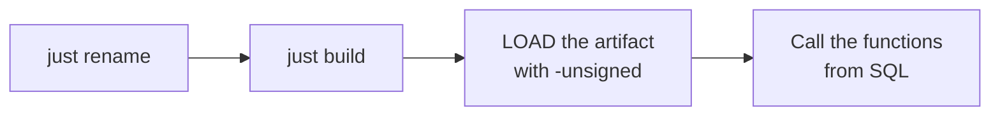

# Quick start

The whole page in four steps:



## Prerequisites

- **Rust** 1.86 or newer (`rust-version` in `Cargo.toml`).
- **[just](https://github.com/casey/just)** — the tool the recipes call:

  ```shell
  cargo install just
  ```

- **make** (inside Git Bash on Windows) and **Python 3** — the official DuckDB
  `extension-ci-tools` build/test flow, which `just build` runs under the hood (`make configure` +
  `make debug`). `just test` uses the same flow.
- A **DuckDB** binary 1.3 or newer (`duckdb` on `PATH`, or point at it with
  `just DUCKDB=/path/to/duckdb …`).

## 1. Rename the extension

```shell
just rename csv_stats
```

`scripts/rename.sh` rewrites the five places the extension name has to match — `Cargo.toml`
(`[package] name`), `EXTENSION_NAME` in the Makefile, the entry-point symbol in
`src/extension/mod.rs`, the Justfile and the CI workflow — plus every occurrence in the docs, and
regenerates the `Cargo.lock` entry. It finishes by printing what still needs a human pass; the functions
and their tests are the main item.

### After renaming

What is left once the name is consistent everywhere:

1. **`AGENTS.md`** — fill in the `{{PROJECT_GOAL}}` placeholder, and set the function-name prefix in the
   naming convention to your own (the prefix here is `open_`).
2. **The template's sample functions and `test/sql/*.test`** — replace them with your API; see [writing
   functions](./writing-functions.md) and [testing](./testing.md). This repository has already done that: seven
   function files under `src/extension/functions/` covering nine SQL names, the platform layer in
   `src/extension/launcher.rs`, the persistence layer in `src/extension/writer.rs`, the options STRUCT in
   `src/extension/types/open_write_options.rs`, and one `.test` per function file under `test/sql/` plus a
   smoke test.
3. **`community-extension/description.yml`** — `extension.name` / `description` / `maintainers` / `repo`
   are yours to fill in; the field-by-field reasoning is in
   [community extensions](./community-extension.md).
4. **`LICENSE`** — the copyright holder, and the duckfn version in `Cargo.toml`.
5. **Before the first release**, make sure the repository has a `main` branch and an `origin` remote:
   `just release_tag` pushes both.

## 2. Build

```shell
just build          # = make configure && make debug
```

The artifact is `build/debug/duckfn_open.duckdb_extension`. There is no C++ step and no local DuckDB
build: the extension is compiled against DuckDB's headers and dispatches through its API table when it
is loaded.

## 3. Load and call it

```shell
just repl           # a DuckDB REPL with the extension already loaded
```

```sql
-- or by hand; -unsigned is required for a locally built extension
duckdb -unsigned -c "LOAD './build/debug/duckfn_open.duckdb_extension';"
```

What the extension registers, read straight out of the catalog. Every `sql` fence on this page is a static
code block — the site runs nothing in the browser — so paste them into the REPL above (or load the
artifact into your own `duckdb -unsigned` first):

```sql
SELECT function_name, len(parameters) AS args, return_type
FROM duckdb_functions()
WHERE starts_with(function_name, 'open_')
ORDER BY function_name, args;
```

Nine SQL names, twenty-one signatures, and every one of them is a scalar function — no aggregate, no table
function. Seven names carry more than one signature under a single SQL name, merged with `overloads_name`,
which is why the signature count outruns the name count:

```text
open_path(path)                    open_path(path, app)
open_path_detached(path)           open_path_detached(path, app)
open_commands(path)

open_write(content|blob, ext)      open_write(content|blob, ext, opts)
open_content(content|blob, ext)    open_content(content|blob, ext, opts)
open_html(content)
open_print(text)                   open_print(text, tail)

open_filename(value)               open_filename(value, replacement)
                                   open_filename(value, replacement, truncate, windows)
open_filename_check(value)         open_filename_check(value, truncate, windows)
```

The one type it registers is the options argument of the write family:

```sql
SELECT type_name, logical_type
FROM duckdb_types()
WHERE starts_with(type_name, 'open_');
```

That is `open_write_options(dir VARCHAR, "name" VARCHAR, part VARCHAR)` — `name` carries quotes because NAME
is a keyword in DuckDB's grammar. Both the signatures and the type are declared in Rust; see [writing
functions](./writing-functions.md). The filename pair registers no type alongside them: its arguments are
plain `VARCHAR` and `BOOLEAN`, which is worth asserting once in a test, because a Rust argument name is not a
SQL type.

A call that starts no process gives the same answer everywhere, which is why `NULL` is the portable demo:

```sql
SELECT open_path(NULL) AS opened;   -- NULL input short-circuits, so no launcher is called at all
```

The failure path is worth running too — an empty argument is an error, not a `false`:

```sql
SELECT open_path('');    -- error: the path or URL must not be empty
```

The write family answers the same way on every machine, because it needs no desktop at all: `open_write`
returns the path it wrote and starts nothing, `open_print` puts the text on the console and returns `NULL`.

```sql
SELECT open_write('report body', 'md', {'dir':'./out', 'name':'report', 'part':NULL});
-- ./out/report.md — a missing directory is created, nothing is started

SELECT open_print('row ' || x) FROM range(3) t(x);  -- three lines on the console, three NULLs in SQL
```

The filename pair asks for even less — one string in, a string or a `BOOLEAN` out, no desktop and no file
system — so it is the one family whose every answer can be asserted verbatim. Its rules and defaults are
[`sanitize-filename`](https://crates.io/crates/sanitize-filename)'s own (illegal characters, control
characters, all-dot names, the Windows reserved device names, trailing dots and spaces, a cut at 255 **bytes**),
with one pinned exception: `windows` is `true` whatever the host is, because the crate takes the compiling
platform and one query must answer the same way on every machine. It is *not* a helper of the write family,
which uses the same crate under a different policy.

```sql
SELECT open_filename('quarterly/report:v2.csv');    -- 'quarterlyreportv2.csv': the defaults delete, they do not substitute
SELECT open_filename('a/b:c?.txt', '_');            -- 'a_b_c_.txt': pass a replacement to see where it edited
SELECT open_filename_check('CON.txt');              -- false: a Windows reserved device name
SELECT count(*) FROM (VALUES ('a.txt'), ('b/c.txt')) t(name)
WHERE NOT open_filename_check(name);                -- 1: how many names would be touched, changed by nothing
```

`open_filename` has no three-argument form: `truncate` and `windows` only come as a pair, so
`open_filename(x, '_', true)` is a binder error. That gap is the one compression in this API and it is
deliberate — the reason is in `src/extension/functions/scalar_open_filename.rs`.

What an actual launch answers depends on this machine's desktop: which launchers are installed, and what
`.html` is associated with. There is no second place to run it — this extension builds for desktop targets
only, see [build and release](./build-and-release.md).

```sql
SELECT open_path('report.html');                    -- default program, waits for the launcher
SELECT open_path('https://duckdb.org', 'firefox');  -- a program of your choosing
SELECT open_path_detached('report.html');           -- returns as soon as the launcher started
SELECT open_commands('report.html');                -- the candidate commands, running none
SELECT open_content('<svg xmlns="http://www.w3.org/2000/svg"/>', 'svg',
                    {'dir':'./out', 'name':NULL, 'part':'chart'});
                                                    -- write it out, then open it with the default program
SELECT open_html('<h1>hello</h1>');                 -- the same with nothing to configure: .html, browser
```

A single query from the command line, without a REPL:

```shell
just sql "SELECT open_path(NULL)"
```

## 4. Run the tests

```shell
just test           # make configure + make debug + make test, then a cleanup of what the tests wrote
```

Eight files under `test/sql/`, and three of them really execute: `open_write.test` writes files and reads them
back, `open_print.test` writes to stdout, `open_filename.test` asserts whole rewrites on the strings it gets
back — no process, no file system, so nothing there depends on the machine. The files land under `test/sql/`
(`named/`, `blob/`, `unique/` …), git-ignored and swept away by that cleanup step.
[Testing](./testing.md) covers that, the faster loop, and what a new function should cover.

## Traps

:::warning[Three things that look like bugs and are not]

- **`-unsigned` is mandatory** when you load a locally built extension. Without it DuckDB refuses
  the file.
- **The artifact file name must stay `<extension name>.duckdb_extension`.** DuckDB finds the
  entry-point symbol through the file name, so a copy called `win.duckdb_extension` fails with
  `did not contain function "duckfn_open_init_c_api"`.
- **`make test` does not rebuild.** After changing Rust code run `just ci-build` (or `make debug`)
  first, otherwise the tests run against the previous artifact.

:::

One more, on Windows: if `make debug` reports the artifact is in use, a DuckDB process is
holding `build/debug/duckfn_open.duckdb_extension` (usually a `just repl` left open) — close that
process and rebuild. A `.duckdb_extension` is not a renamed DLL: DuckDB's metadata lives at the end of
the file, so copying a DLL over it produces `The metadata at the end of the file is invalid`.
