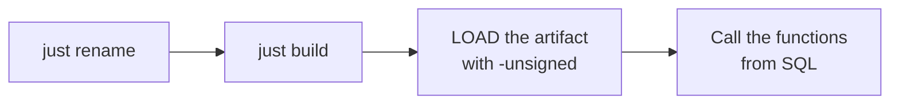

# Quick start

The whole page in four steps:



## Prerequisites

- **Rust** 1.86 or newer (`rust-version` in `Cargo.toml`).
- **[just](https://github.com/casey/just)** — the tool the recipes call:

  ```shell
  cargo install just
  ```

- **make** (inside Git Bash on Windows) and **Python 3** — the official DuckDB
  `extension-ci-tools` build/test flow, which `just build` runs under the hood (`make configure` +
  `make debug`). `just test` uses the same flow.
- A **DuckDB** binary 1.3 or newer (`duckdb` on `PATH`, or point at it with
  `just DUCKDB=/path/to/duckdb …`).

## 1. Rename the extension

```shell
just rename csv_stats
```

`scripts/rename.sh` rewrites the five places the extension name has to match — `Cargo.toml`
(`[package] name`), `EXTENSION_NAME` in the Makefile, the entry-point symbol in
`src/extension/mod.rs`, the Justfile and the CI workflow — plus every occurrence in the docs, and
regenerates the `Cargo.lock` entry. It finishes by printing what still needs a human pass; the functions
and their tests are the main item.

### After renaming

What is left once the name is consistent everywhere:

1. **`AGENTS.md`** — fill in the `{{PROJECT_GOAL}}` placeholder, and set the function-name prefix in the
   naming convention to your own (the prefix here is `open_`).
2. **The template's sample functions and `test/sql/*.test`** — replace them with your API; see [writing
   functions](./writing-functions.md) and [testing](./testing.md). This repository has already done that:
   `open_path` / `open_path_detached` / `open_commands` in `src/extension/functions/`, the platform layer
   in `src/extension/launcher.rs`, and one `.test` per function file under `test/sql/`.
3. **`community-extension/description.yml`** — `extension.name` / `description` / `maintainers` / `repo`
   are yours to fill in; the field-by-field reasoning is in
   [community extensions](./community-extension.md).
4. **`LICENSE`** — the copyright holder, and the duckfn version in `Cargo.toml`.
5. **Before the first release**, make sure the repository has a `main` branch and an `origin` remote:
   `just release_tag` pushes both.

## 2. Build

```shell
just build          # = make configure && make debug
```

The artifact is `build/debug/duckfn_open.duckdb_extension`. There is no C++ step and no local DuckDB
build: the extension is compiled against DuckDB's headers and dispatches through its API table when it
is loaded.

## 3. Load and call it

```shell
just repl           # a DuckDB REPL with the extension already loaded
```

```sql
-- or by hand; -unsigned is required for a locally built extension
duckdb -unsigned -c "LOAD './build/debug/duckfn_open.duckdb_extension';"
```

What the extension registers, read straight out of the catalog. Every `sql` fence on this page is a static
code block — the site runs nothing in the browser — so paste them into the REPL above (or load the
artifact into your own `duckdb -unsigned` first):

```sql
SELECT function_name, len(parameters) AS args, return_type
FROM duckdb_functions()
WHERE function_name IN ('open_path', 'open_path_detached', 'open_commands')
ORDER BY function_name, args;
```

Three SQL names, five signatures: each launcher name has a `(path)` and a `(path, app)` form, merged into
one function set with `overloads_name`.

A call that starts no process gives the same answer everywhere, which is why `NULL` is the portable demo:

```sql
SELECT open_path(NULL) AS opened;   -- NULL input short-circuits, so no launcher is called at all
```

The failure path is worth running too — an empty argument is an error, not a `false`:

```sql
SELECT open_path('');    -- error: the path or URL must not be empty
```

What an actual launch answers depends on this machine's desktop: which launchers are installed, and what
`.html` is associated with. There is no second place to run it — this extension builds for desktop targets
only, see [build and release](./build-and-release.md).

```sql
SELECT open_path('report.html');                    -- default program, waits for the launcher
SELECT open_path('https://duckdb.org', 'firefox');  -- a program of your choosing
SELECT open_path_detached('report.html');           -- returns as soon as the launcher started
SELECT open_commands('report.html');                -- the candidate commands, running none
```

A single query from the command line, without a REPL:

```shell
just sql "SELECT open_path(NULL)"
```

## 4. Run the tests

```shell
just test           # make configure + make debug + make test
```

The faster loop is in [Testing](./testing.md).

## Traps

:::warning[Three things that look like bugs and are not]

- **`-unsigned` is mandatory** when you load a locally built extension. Without it DuckDB refuses
  the file.
- **The artifact file name must stay `<extension name>.duckdb_extension`.** DuckDB finds the
  entry-point symbol through the file name, so a copy called `win.duckdb_extension` fails with
  `did not contain function "duckfn_open_init_c_api"`.
- **`make test` does not rebuild.** After changing Rust code run `just ci-build` (or `make debug`)
  first, otherwise the tests run against the previous artifact.

:::

One more, on Windows: if `make debug` reports the artifact is in use, a DuckDB process is
holding `build/debug/duckfn_open.duckdb_extension` (usually a `just repl` left open) — close that
process and rebuild. A `.duckdb_extension` is not a renamed DLL: DuckDB's metadata lives at the end of
the file, so copying a DLL over it produces `The metadata at the end of the file is invalid`.
