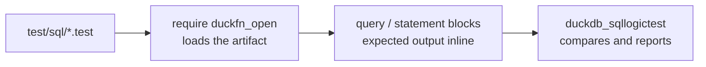

# Testing

Tests are [SQLLogicTest](https://duckdb.org/dev/sqllogictest/intro) files under `test/sql/`, the same
format DuckDB uses for its own test suite. A file is a sequence of `query` and `statement` blocks with the
expected result inline, so a test doubles as a worked example of the function's behaviour. There are seven:
one per function file under `src/extension/functions/`, plus a smoke test.

| File | What it covers |
| --- | --- |
| `duckfn_open.test` | Smoke test. Before `LOAD`, four of the names (`open_path`, `open_commands`, `open_write`, `open_print`) answer `does not exist`; after it the catalog is read twice — the seven `open_` names concatenated in order as one string, and a `count(*)` of sixteen signatures. Then `open_commands` on a file that really exists in the test directory (it starts nothing), and `SELECT open_path(NULL)` is `NULL`. Also the smallest proof that the extension loads at all. |
| `open_path.test` | The two launcher names as a function set: their registration shape from the catalog (arity 1 and 2, `BOOLEAN`), constant **and** runtime `NULL` short-circuited so no launcher is ever called, the four empty-argument error messages, binder errors for the wrong arity and the wrong type, plus the assertion that the Rust branch names (`open_path_with`, `open_path_detached_with`) did not leak out as extra SQL functions. |
| `open_commands.test` | The read-only preview, the one launch answer that can be executed anywhere: `VARCHAR[]` both from the catalog and from `typeof`, a non-empty candidate list, at least one candidate carrying the path itself, both `NULL` short-circuits, the empty-path error, binder errors for a second argument and for a number, and 3000 rows across several DataChunks. |
| `open_write.test` | **Runs for real**: it starts no process, so every step is assertable on a machine with no desktop. One name with four signatures (arity 2 and 3, exactly two of them `BLOB`, all returning `VARCHAR`); an explicit `dir` + `name` coming back as that exact path and its content read back with `read_text`; overwrite semantics — a short second body leaves a short file; a missing directory created down to `nested/a/b`; the generated name matched against `open-<8 digits>-<6 digits>-<part>-<random>.<ext>` with `regexp_matches`, with and without a `part`; PNG magic bytes round-tripped through a `BLOB` and `read_blob` + `hex`; the four option-validation errors; a sanitized `name` that cannot leave its directory; the three `NULL` short-circuits (content, extension, and a whole `NULL` options STRUCT, which is *not* "the rest at their defaults"); and the omitted third argument, which really writes into the system temp directory and is read back. |
| `open_content.test` | Shape and pre-launch validation only — **no call here reaches a launch**. The four signatures and their single `VARCHAR` return type; the same writer errors with `open_content:` in front; `NULL` short-circuits (constant and runtime); a binder error for a fourth argument. One assertion proves the failure is early: after the unusable-name error, `glob()` over that directory counts 0 files — nothing was written, so nothing could be opened. |
| `open_html.test` | The zero-configuration shortcut, and for the same reason never launched: one name, one signature, `VARCHAR` in and `VARCHAR` out, and no `BLOB` signature (counted as 0); binder errors for two arguments, for none, and for a number; `NULL` short-circuited both ways. The file ends by recording that the empty string *is* content — it would write and open a browser — so that one is left to manual verification instead of asserted. |
| `open_print.test` | **Runs for real**: no process, no file system, just stdout, which lands in the runner's own console and never enters the result set — so the assertions are all about the SQL answer, which is always `NULL`. Both arities and their return type; the empty string; a `tail` of `''` and a `tail` of two newlines; three rows that print three times because the argument references a column (a constant argument is folded into one call, which proves nothing); both `NULL` short-circuits; three binder errors; and no leaked `open_print_with_tail`. |

The rule these files are built around: **assert what a machine without a desktop can still answer.** The
four names that reach the desktop — `open_path`, `open_path_detached`, `open_content`, `open_html` — are
never called for a launch anywhere in the suite. Whether a launch returns `true` depends on which launchers
are installed and what `.html` is associated with, and a CI runner has neither, where every action can only
come back `false`. Those names are checked through the catalog, through `NULL`, through what the binder
rejects, and — for `open_content` and `open_html` — through the validation errors that return **before** any
write or launch: a check that fails there starts no process either, so it holds on every machine. What does
run for real starts nothing: `open_commands` lists commands without running them, `open_write` writes files
and reads them back, `open_print` writes to the console.

## Running them

How a file reaches the runner:



```shell
just test                 # make configure + make debug, then make test, then a cleanup
just ci-build             # just the official build, without the tests
```

`just test` goes through DuckDB's official Makefile flow, which is also what CI runs. It starts from its
`ci-build` dependency (`make configure` + `make debug`), runs `make test`, and ends with
`git clean -fdX -- test/sql`. Three things to know:

- **`just test` rebuilds; `make test` by itself does not.** After changing Rust code, `make test` — or the
  runner below — grades whatever artifact was built last, so build first (`just ci-build` or `make debug`).
- **On Windows `make` has to run inside Git Bash**, not PowerShell.
- **The cleanup line is load-bearing, and it does not run when a test fails.** `just` aborts at the failing
  recipe line, so the files a persistence test wrote stay under `test/sql/` until the suite goes green.
  That is why the assertions there are written the way they are — see [Where the tests
  write](#where-the-tests-write).

### The fast loop

DuckDB's test runner can drive the artifact directly, which skips `make` entirely. The recipe needs a
Python environment with `duckdb_sqllogictest` installed — `make configure` creates one under
`configure/venv`, or you can use any Python 3 environment that has it:

```bash
# Linux / macOS
./configure/venv/bin/python -m duckdb_sqllogictest \
    --test-dir test/sql \
    --external-extension build/debug/duckfn_open.duckdb_extension
```

```powershell
# Windows
.\configure\venv\Scripts\python.exe -m duckdb_sqllogictest `
    --test-dir test/sql `
    --external-extension build/debug/duckfn_open.duckdb_extension
```

`--test-dir` is required: it is also the value of `__TEST_DIR__`, the directory a test writing files is
given. To run a single file, add `--file-path test/sql/open_write.test`. Nothing cleans up afterwards —
this route leaves the files where the tests wrote them.

## Where the tests write

`__TEST_DIR__` is `--test-dir` verbatim, and in this runner that is `test/sql` itself. So a test that
writes a file writes it into the repository:

```text
test/sql/named/report.md
test/sql/blob/magic.png
test/sql/unique/open-20261013-200706-Sales_Overview-2U9nzK.svg
test/sql/nested/a/b/deep.txt      the directory was created with its parents
```

`test/sql/*.*` was already ignored; `test/sql/*/` covers the directories, so none of this shows up in
`git status`, and `just test`'s closing `git clean -fdX -- test/sql` removes it (`-X` deletes ignored files
only, so the tracked `.test` files stay).

Two consequences for how a persistence assertion is written.

**Be immune to residue.** A failed run leaves the cleanup unswept, so "how many files are in this directory"
is an assertion about the last run, not this one. `open_write.test` keeps the two paths it was given and
counts only the files matching **those**:

```sql
CREATE TEMP TABLE auto_named AS (
    SELECT open_write('first', 'txt', {'dir':'__TEST_DIR__/unique','name':NULL,'part':NULL}) AS a,
           open_write('second','txt', {'dir':'__TEST_DIR__/unique','name':NULL,'part':NULL}) AS b
);

SELECT count(*) = 2
FROM glob('__TEST_DIR__/unique/*') g, auto_named t
WHERE replace(g.file, chr(92), '/') IN (t.a, t.b);    -- true
```

**`glob()` uses the platform separator, the extension always uses `/`.** On Windows `glob()` answers
`test\sql\unique\open-…txt` while `open_write` answers `test/sql/unique/open-…txt`, so the two sides have to
be normalized before they are compared (`replace(g.file, chr(92), '/')`). Skip that and the assertion
silently never holds on Windows — which also makes this the one place where the "always `/`" convention is
machine-checked.

One more, about reading a file back: the argument of `read_text` / `read_blob` has to be an expression the
binder can fold into a constant. `read_text(open_write('x', 'txt', {'dir':'…', 'name':'a', 'part':NULL}))`
is fine, because every argument on both sides of the composition is a literal;
`read_text((SELECT a FROM t))` is not — `Binder Error: Table function cannot contain subqueries`. So read
the content back in the statement that produced the path, or from a literal path.

## Conventions

- **Every file starts from a clean database**, so `duckfn_open.test` can assert that the names do
  not exist before the extension is loaded, and the other files start with `require duckfn_open`.
- **Expected errors are matched as substrings.** Under `statement error`, a distinctive fragment of the
  message is enough — there is no need to reproduce DuckDB's whole error string, and doing so ties the
  test to a message that may well change. This project's own text is written out (`open_path: the path or
  URL must not be empty`, `open_write_options.dir must not be empty`), with the SQL name in front of it.
  That prefix comes from the generated `SQL_NAME`, not from the Rust function name, so the three-argument
  `open_write_with` still reports `open_write: …` — which is what a caller in SQL should see.
- **A test must not reach a launch.** Nothing here asserts on a real launch: registration shape comes from
  `duckdb_functions()`, `open_commands` runs because it starts nothing by design, and the two names that
  would open something (`open_content`, `open_html`) are only ever called in ways that fail before the
  launch — or short-circuit on `NULL`.
- **A persistence test proves the bytes, not just the path.** `open_write.test` reads every file back
  through `read_text` / `read_blob`; the path assertion alone would only say what was promised, not what
  landed.
- **Watch how values print.** A `DOUBLE` renders as `7.0`; when a test is about a number rather than a
  type, cast it (`SUM(x)::DECIMAL(10,1)`) so the expectation stays stable if the type changes.
- **Catalog name searches need care with `LIKE`.** Its `_` matches any single character, so
  `function_name LIKE '%_with%'` hits names you never meant to include; the function-set tests name the
  branch functions with `IN (…)` instead. (`LIKE 'open_%'` in the smoke test is the same wildcard, harmless
  only because no other name starts with `open` followed by any character.)
- **Divide the files by concern**, not by function count: behaviour in one file, error paths in another,
  and a `.test` that reaches for a community extension (for HTML parsing, say) kept separate, because it
  needs the network the first time.

## What a new function should cover

At least: ordinary values, `NULL`, a boundary value, and the error path. Three more that pay off:

- the node before the `LOAD` (`statement error` … `does not exist`), if the file is the smoke test;
- a NULL input in a chunk that is *not* constant-folded, since a constant `NULL` never reaches the body —
  for a launcher that is the case where a window would still open, and for `open_write` the case where a
  file would still be created;
- more rows than `STANDARD_VECTOR_SIZE` (2048), which is what exercises `combine` for an aggregate and
  the per-chunk path for a scalar (`open_commands.test` does the latter with `range(3000)`).

For a function that talks to the operating system, also cover what the catalog says about it: every arity
and return type under its SQL name, no extra name from the Rust side, and — when it takes an options
STRUCT — how many of its signatures accept a `BLOB` (`open_write.test` and `open_content.test` both count
them rather than trusting the list).

Before committing: `just lint` (`cargo clippy --all-targets -- -D warnings`). The naming and sanitizing
rules in `src/extension/writer.rs` additionally have Rust unit tests (`cargo test`, twelve of them) — a
convenience the SQL files do not have, because `TempDir` deletes the whole scratch directory when a test
ends and `assert_eq!` compares paths without a string rewrite. They are not part of `just test`, which
only runs the `.test` files.
