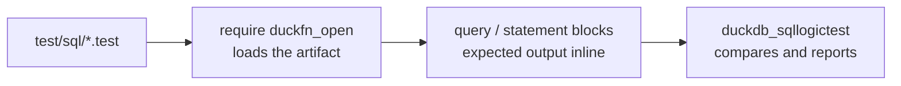

# Testing

Tests are [SQLLogicTest](https://duckdb.org/dev/sqllogictest/intro) files under `test/sql/`, the same
format DuckDB uses for its own test suite. A file is a sequence of `query` and `statement` blocks with
the expected result inline, so a test doubles as a worked example of the function's behaviour.

| File | What it covers |
| --- | --- |
| `duckfn_open.test` | Smoke test: the names do not exist before `LOAD`, the three `open_` names do exist after it (read out of `duckdb_functions()`, without calling anything), `open_commands` runs for real on this machine, and `SELECT open_path(NULL)` is `NULL`. Also the smallest proof that the extension loads at all. |
| `open_path.test` | The two launcher names as a function set: their registration shape from the catalog (arity 1 and 2, `BOOLEAN`), constant **and** runtime `NULL` short-circuited so no launcher is ever called, the four empty-argument error messages, binder errors for the wrong arity and the wrong type, plus the assertion that the Rust branch names (`open_path_with`, `open_path_detached_with`) did not leak out as extra SQL functions. |
| `open_commands.test` | The read-only path, which is the one that can be executed anywhere: the `VARCHAR[]` return type, a non-empty candidate list, at least one candidate carrying the path itself, both `NULL` short-circuits, the empty-path error, binder errors, and 3000 rows across several DataChunks. |

The rule these files are built around: **assert what a machine without a desktop can still answer.**
Whether `open_path('report.html')` returns `true` depends on which launchers are installed and what
`.html` is associated with — and a CI runner has neither, where every action can only come back `false`.
So the launcher names are checked through the catalog, through `NULL`, through their error messages, and
through what the binder rejects; the only function whose result is actually computed row by row is
`open_commands`, the one that starts no process.

## Running them

How a file reaches the runner:



```shell
just test                 # = make configure + make debug + make test
just ci-build             # just the official build, without the tests
```

`just test` goes through DuckDB's official Makefile flow, which is also what CI runs. Two things to
know about it:

- **It does not rebuild.** After touching Rust code run `just ci-build` (or `make debug`) first, or the
  tests run against the previous artifact.
- **On Windows `make` has to run inside Git Bash**, not PowerShell.

### The fast loop

DuckDB's test runner can drive the artifact directly, which skips `make` entirely. The recipe needs a
Python environment with `duckdb_sqllogictest` installed — `make configure` creates one under
`configure/venv`, or you can use any Python 3 environment that has it:

```bash
# Linux / macOS
./configure/venv/bin/python -m duckdb_sqllogictest \
    --test-dir test/sql \
    --external-extension build/debug/duckfn_open.duckdb_extension
```

```powershell
# Windows
.\configure\venv\Scripts\python.exe -m duckdb_sqllogictest `
    --test-dir test/sql `
    --external-extension build/debug/duckfn_open.duckdb_extension
```

`--test-dir` is required: it is also the value of `__TEST_DIR__`, the directory a test writing files is
given. To run a single file, add `--file-path test/sql/open_path.test`.

## Conventions

- **Every file starts from a clean database**, so `duckfn_open.test` can assert that the names do
  not exist before the extension is loaded, and the other files start with `require duckfn_open`.
- **Expected errors are matched as substrings.** Under `statement error`, a distinctive fragment of the
  message is enough — there is no need to reproduce DuckDB's whole error string, and doing so ties the
  test to a message that may well change. The messages from `launcher::check_not_empty` are asserted
  in full (`open_path: the path or URL must not be empty`), because they are this project's own text.
- **A test must not start a process.** Nothing here asserts on a real launch: registration shape comes
  from `duckdb_functions()`, and only `open_commands` — which runs no launcher by design — gets called for
  its result.
- **Watch how values print.** A `DOUBLE` renders as `7.0`; when a test is about a number rather than a
  type, cast it (`SUM(x)::DECIMAL(10,1)`) so the expectation stays stable if the type changes.
- **Catalog name searches need care with `LIKE`.** Its `_` matches any single character, so
  `function_name LIKE '%_with%'` hits names you never meant to include; the function-set test names the
  two branch functions with `IN (…)` instead.
- **Divide the files by concern**, not by function count: behaviour in one file, error paths in
  another, and a `.test` that reaches for a community extension (for HTML parsing, say) kept separate,
  because it needs the network the first time.

## What a new function should cover

At least: ordinary values, `NULL`, a boundary value, and the error path. Three more that pay off:

- the node before the `LOAD` (`statement error` … `does not exist`), if the file is the smoke test;
- a NULL input in a chunk that is *not* constant-folded, since a constant `NULL` never reaches the body —
  that is the case where a launcher would still be called, so it is worth asserting it is not;
- more rows than `STANDARD_VECTOR_SIZE` (2048), which is what exercises `combine` for an aggregate and
  the per-chunk path for a scalar (`open_commands.test` does the latter with `range(3000)`).

For a function that talks to the operating system, also cover what the catalog says about it: every arity
and return type under its SQL name, and no extra name from the Rust side.

Before committing: `just lint` (`cargo clippy --all-targets -- -D warnings`).
