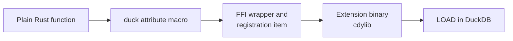

# Writing functions

A registered function is "an ordinary Rust function plus one attribute macro". The macro writes the FFI
wrapper, reads the argument columns, writes the result column, and submits the registration; the body
holds nothing but your logic.

The path from a plain function to a callable SQL function:



## What this extension registers

Three SQL names, five signatures, all scalar. The bodies hold no logic of their own: they validate the
argument and hand it to `launcher.rs`, which is where `open` is called (see [project
structure](./project-structure.md)).

| SQL name | Signature | Rust function | File | Behaviour |
| --- | --- | --- | --- | --- |
| `open_path` | `VARCHAR -> BOOLEAN` | `open_path` | `scalar_open_path.rs` | Default program, waits for the launcher. |
| `open_path` | `VARCHAR, VARCHAR -> BOOLEAN` | `open_path_with` | `scalar_open_path.rs` | Same, with the program named. |
| `open_path_detached` | `VARCHAR -> BOOLEAN` | `open_path_detached` | `scalar_open_path.rs` | Returns as soon as the launcher started. |
| `open_path_detached` | `VARCHAR, VARCHAR -> BOOLEAN` | `open_path_detached_with` | `scalar_open_path.rs` | Same, with the program named. |
| `open_commands` | `VARCHAR -> VARCHAR[]` | `open_commands` | `scalar_open_commands.rs` | Lists the candidate commands, starts no process. |

`NULL` in and nothing runs: a `NULL` path short-circuits to `NULL`, which is how SQL tells "no input on
this row" apart from "no launcher could be started" (`false`).

## Scalars: three return shapes

The macro generates different code per return type:

| Signature | Meaning |
| --- | --- |
| `-> T` | A plain value, never NULL. |
| `-> DuckOptionResult<T>` | Nullable and fallible: `Ok(None)` becomes SQL `NULL`, `Err` fails the whole query. |
| `-> Option<T>` | Nullable but unable to fail. |

```rust
use duckfn::{DuckOptionResult, duck_scalar_function};

use crate::extension::launcher;

#[duck_scalar_function(
    description = "Opens a local path or URL with the program the desktop is configured to use",
    comment = "true once a launcher has been started, false when none could be started; NULL input \
               short-circuits to NULL and starts nothing",
    examples = [
        "SELECT open_path('report.html')",
        "SELECT open_path('https://duckdb.org', 'firefox')"
    ]
)]
pub(super) fn open_path(path: String) -> DuckOptionResult<bool> {
    launcher::check_not_empty(open_path::SQL_NAME, "path or URL", &path)?;
    Ok(Some(launcher::open_default(&path)))
}
```

That is the shape every function here uses. `open_path` never actually answers `Ok(None)` — a `NULL`
result comes from the argument short-circuit below, not from the body — but it does need `Err` for the
empty-string check, and `bool` is the answer the launcher gives back. `open_commands` uses the same shape
with `Vec<String>` as the value type, which is SQL `VARCHAR[]`: the return type is read off the Rust type,
so no declaration is needed anywhere.

### Several signatures under one name

Each launcher name takes a `(path)` and a `(path, app)` form. The second one is a separate Rust function
with a different name, folded under the first name by `overloads_name`:

```rust
#[duck_scalar_function(overloads_name = "open_path")]
pub(super) fn open_path_with(path: String, app: String) -> DuckOptionResult<bool> {
    launcher::check_not_empty(open_path_with::SQL_NAME, "path or URL", &path)?;
    launcher::check_not_empty(open_path_with::SQL_NAME, "application", &app)?;
    Ok(Some(launcher::open_with_app(&path, &app)))
}
```

The catalog then shows one SQL name with two arities, and the Rust branch name (`open_path_with`) does not
leak out as an extra function — `test/sql/open_path.test` asserts exactly that.

### What happens to a NULL argument

Argument nullability is decided by the parameter type, and it applies to aggregates too:

- **`path: String`** — what all five signatures here use. A NULL input row is short-circuited to SQL
  `NULL` by duckfn's argument reader; the body never runs for that row, so no launcher is called. This is
  what you want most of the time.
- **`path: Option<String>`** — NULL reaches the body as `None` and its meaning is yours to decide
  (return NULL, substitute a default, count NULLs, …).

### Errors and panics

Return `Err(duck_error("…"))` for a value the function cannot handle; that fails the query with your
message. A `panic!` in the body is caught and reported as a DuckDB error rather than unwinding across
the FFI boundary. Error messages are user-facing: write them in English, and prefix them with the
function name so a report makes sense on its own — the prefix comes from the generated `SQL_NAME`
constant (`open_path: the path or URL must not be empty`), never from a typed-out literal, which is also
why those functions are `pub(super)`: the generated module inherits the function's visibility.

An error at the SQL boundary is the right answer wherever a silent value would explain nothing: the empty
string here would otherwise come back as `false`, indistinguishable from "this machine has no launcher".

## Aggregates: per-row inputs plus a state

:::note[Nothing here registers an aggregate]

This extension is scalar-only. The section below is duckfn's pattern, kept because it is the other half of
what these macros can do; a runnable implementation lives in duckfn's own example extension
(`src/extension/functions/aggregate_function.rs` under the unpacked crate, see [project
structure](./project-structure.md)), not in this repository.

:::

An aggregate signature is "the input columns plus one `&mut` state parameter" (in any position). The
state needs `Default + Clone + Debug` — the wrapper struct the macro generates derives them — and an
implementation of `DuckAggregateState`:

- `combine` / `simple_combine` merges two states. This is what threads and group merging go through,
  so it has to be associative.
- `result` / `simple_result` turns a state into the group's value. `simple_result` can only produce a
  never-NULL value; override `result` and return `Ok(None)` when a group has to come back as SQL NULL.
- `Output` decides the SQL return type: `i64`, `f64`, `String`, `Vec<…>` (that is, `list<…>`) and so on.

```rust
#[derive(Default, Debug, Clone)]
struct SumState {
    total: f64,
    rows: i64,
}

impl DuckAggregateState for SumState {
    type Output = f64;

    fn simple_combine(&mut self, other: &Self) {
        self.total += other.total;
        self.rows += other.rows;
    }

    fn result(&self) -> DuckOptionResult<f64> {
        if self.rows == 0 {
            Ok(None)          // no row at all -> SQL NULL, not 0
        } else {
            Ok(Some(self.total))
        }
    }
}
```

`SumState` counts the rows it saw so "no input at all" is told apart from "input seen, the total is
0". A state may equally hold a `String`, a `HashMap`, a `Vec<…>`, or one slot per group key — see the
aggregate chapter of the duckfn guide for the shapes it supports.

## Adding your own

1. **Pick the attribute.** Scalar, aggregate, table function, `COPY`, cast, SQL macro or replacement
   scan: each has one, and each accepts only its own arguments. The reference is
   [the duckfn user guide](https://shijianjs.github.io/duckfn/) — the chapter for that kind.
2. **Copy the closest function** from `src/extension/functions/` and change the logic, rather than
   inventing a signature from scratch. `scalar_open_commands.rs` is the smallest complete one (a
   `VARCHAR -> VARCHAR[]` scalar whose body is two lines); `scalar_open_path.rs` adds the second signature
   and the `overloads_name` merge.
3. **Put the platform work in the platform layer.** A body here does validation and one call. Anything that
   differs per target — `#[cfg]`, a crate only one platform can compile — belongs in
   `src/extension/launcher.rs`, so the function files keep seeing one shape. This project builds for
   desktop targets only, so there is no `#[cfg]` in the tree and `open` is an ordinary `[dependencies]`
   entry rather than a `[target.'cfg(…)'.dependencies]` one; keep it that way unless you actually add a
   second target family. See [project structure](./project-structure.md).
4. **Attach it to the module tree**: one `mod …;` line per file in `src/extension/functions/mod.rs`.
   The crate root stays untouched.
5. **Write the documentation metadata** on the attribute — `description`, `comment`, `example` /
   `examples`:

   ```rust
   #[duck_scalar_function(
       description = "Lists, without running them, the launcher commands open_path would try in order",
       comment = "The read-only pair of open_path: nothing is started, so the result is stable enough to \
                  assert in CI on a headless runner",
       example = "SELECT open_commands('report.html')"
   )]
   ```

   DuckDB's C extension API has no way to set a description or an example, so this text is the only
   source for the `Added Functions` table on the community-extension page. `just docs_csv` exports it
   to `target/function_descriptions.csv` (see [Community extensions](./community-extension.md)).
   Write it in English — it is pasted onto that page as it is.
6. **Cover it with a test** (see [Testing](./testing.md)) and run `just lint`.

### Names

Every SQL name carries one short prefix (`open_` here), and the part after it should read like what the
function does. A prefixed name is also what users type, so resist `open_open_thing`.

The attribute registers the **Rust function name** by default, which is why `open_commands` and
`open_path_detached` need no extra argument at all. A second signature under a name already in use comes
through `overloads_name = "open_path"` instead (see [Several signatures under one
name](#several-signatures-under-one-name)), and then the Rust name and the SQL name differ on purpose.

The macro also generates a `SQL_NAME` constant per signature. Once a name appears in several places —
error prefixes, log lines, hints — read that constant rather than repeating the literal; the price is
that such a function has to be `pub(super)`, because the generated module inherits the function's
visibility.

### Options arguments

A configuration argument (`DuckLazy<T>`) is parsed once and read inside the function, so per-row
parsing does not show up in profiles. This extension does not use one; the pattern (a named STRUCT type,
created at load time) is documented in the duckfn guide and used throughout
[duckfn_quantstats](https://github.com/shijianjs/duckfn-quantstats).
