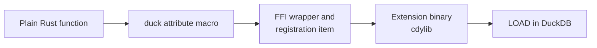

# Writing functions

A registered function is "an ordinary Rust function plus one attribute macro". The macro writes the FFI
wrapper, reads the argument columns, writes the result column, and submits the registration; the body
holds nothing but your logic.

The path from a plain function to a callable SQL function:



## What this extension registers

Nine SQL names, twenty-one signatures, all scalar, plus one STRUCT type (`op_write_file_options`) that carries
the optional arguments of the write family. Most bodies hold no logic of their own: they validate the
argument and hand it to `launcher.rs` or `writer.rs` — the crates that start a program and the crates that
write a file live behind those two layers, not here (see [project structure](./project-structure.md)). Two
files are the exceptions: `op_print`, whose entire job is a write to stdout, keeps that write in its file,
and `scalar_op_sanitize_filename.rs` calls neither layer at all — it wires the `sanitize-filename` crate's own
surface straight to SQL, with the crate's defaults instead of the write family's policy (the write path still
goes through `writer.rs`, which uses the same crate under a different one). The
SQL-side semantics of every row below — what each value means to a caller — is the
[user guide's function reference](../user-guide/functions/index.md).

| SQL name | Signature | Rust function | File | Behaviour |
| --- | --- | --- | --- | --- |
| `op_open_path` | `VARCHAR -> BOOLEAN` | `op_open_path` | `scalar_op_open_path.rs` | Default program, waits for the launcher. |
| `op_open_path` | `VARCHAR, VARCHAR -> BOOLEAN` | `op_open_path_with` | `scalar_op_open_path.rs` | Same, with the program named. |
| `op_open_path_detached` | `VARCHAR -> BOOLEAN` | `op_open_path_detached` | `scalar_op_open_path.rs` | Returns as soon as the launcher started. |
| `op_open_path_detached` | `VARCHAR, VARCHAR -> BOOLEAN` | `op_open_path_detached_with` | `scalar_op_open_path.rs` | Same, with the program named. |
| `op_open_commands` | `VARCHAR -> VARCHAR[]` | `op_open_commands` | `scalar_op_open_commands.rs` | Lists the candidate commands, starts no process. |
| `op_write_file` | `VARCHAR, VARCHAR -> VARCHAR` | `op_write_file` | `scalar_op_write_file.rs` | Writes text out, returns the path, starts nothing. |
| `op_write_file` | `VARCHAR, VARCHAR, op_write_file_options -> VARCHAR` | `op_write_file_with` | `scalar_op_write_file.rs` | Same, with the directory / name / segment chosen. |
| `op_write_file` | `BLOB, VARCHAR -> VARCHAR` | `op_write_file_blob` | `scalar_op_write_file.rs` | Binary content, written as the bytes it is. |
| `op_write_file` | `BLOB, VARCHAR, op_write_file_options -> VARCHAR` | `op_write_file_blob_with` | `scalar_op_write_file.rs` | Same, with the options. |
| `op_open_content` | `VARCHAR, VARCHAR -> VARCHAR` | `op_open_content` | `scalar_op_open_content.rs` | Writes it out, then opens it. |
| `op_open_content` | `VARCHAR, VARCHAR, op_write_file_options -> VARCHAR` | `op_open_content_with` | `scalar_op_open_content.rs` | Same, with the options. |
| `op_open_content` | `BLOB, VARCHAR -> VARCHAR` | `op_open_content_blob` | `scalar_op_open_content.rs` | Binary content. |
| `op_open_content` | `BLOB, VARCHAR, op_write_file_options -> VARCHAR` | `op_open_content_blob_with` | `scalar_op_open_content.rs` | Binary content, with the options. |
| `op_open_html` | `VARCHAR -> VARCHAR` | `op_open_html` | `scalar_op_open_html.rs` | `op_open_content` with everything default and `html` pinned. |
| `op_print` | `VARCHAR -> VARCHAR` | `op_print` | `scalar_op_print.rs` | Writes to stdout, then a newline, and hands the text back. |
| `op_print` | `VARCHAR, VARCHAR -> VARCHAR` | `op_print_with_tail` | `scalar_op_print.rs` | Same, with what to append instead of the newline (the tail is not returned). |
| `op_sanitize_filename` | `VARCHAR -> VARCHAR` | `op_sanitize_filename` | `scalar_op_sanitize_filename.rs` | Rewrites a string into a usable file name; the crate's defaults (illegal characters deleted, 255-byte cut on, Windows rules on). |
| `op_sanitize_filename` | `VARCHAR, VARCHAR -> VARCHAR` | `op_sanitize_filename_with_replacement` | `scalar_op_sanitize_filename.rs` | Same, with what to substitute instead of deleting. |
| `op_sanitize_filename` | `VARCHAR, VARCHAR, BOOLEAN, BOOLEAN -> VARCHAR` | `op_sanitize_filename_with_options` | `scalar_op_sanitize_filename.rs` | The substitution plus both switches in one call: the 255-byte cut and the Windows rules. |
| `op_sanitize_filename_check` | `VARCHAR -> BOOLEAN` | `op_sanitize_filename_check` | `scalar_op_sanitize_filename.rs` | Rewrites nothing: is this already a usable name? |
| `op_sanitize_filename_check` | `VARCHAR, BOOLEAN, BOOLEAN -> BOOLEAN` | `op_sanitize_filename_check_with_options` | `scalar_op_sanitize_filename.rs` | Same question, with the two switches. |

Six of the nine names touch the outside world — `op_open_path`, `op_open_path_detached`, `op_write_file`,
`op_open_content`, `op_open_html`, `op_print`, fifteen signatures — and every one of their attributes carries
`volatile = true`. `op_open_commands` and the two `op_sanitize_filename*` names are pure and stay foldable.
Without the flag DuckDB folds a constant-argument call into a constant **during optimization**, so a call that
another expression then consumes is evaluated twice (two files, two prints), and `EXPLAIN` performs the side
effect without running the statement at all. Root `AGENTS.md` has the long version; `duckfn_open.test` pins the
roster through `has_side_effects`.

`NULL` in and nothing runs: a `NULL` path launches nothing, a `NULL` content writes no file, a `NULL` text
prints nothing, a `NULL` in any argument of the `op_sanitize_filename` pair rewrites nothing on that row — and the
answer is `NULL` either way, which is how SQL tells "no input on this row" apart from "no launcher could be
started" (`false`), from a path it did write, and from a name that is not yet usable (`false` there is an
answer; `NULL` there was no input).

## Scalars: three return shapes

The macro generates different code per return type, and it recognises exactly three outer shapes:

| Signature | Meaning |
| --- | --- |
| `-> T` | A plain value, never NULL. |
| `-> DuckOptionResult<T>` | Nullable and fallible: `Ok(None)` becomes SQL `NULL`, `Err` fails the whole query. |
| `-> Option<T>` | Nullable but unable to fail. |

```rust
use duckfn::{DuckOptionResult, duck_scalar_function};

use crate::extension::launcher;

#[duck_scalar_function(
    description = "Opens a local path or URL with the program the desktop is configured to use",
    comment = "true once a launcher has been started, false when none could be started; NULL input \
               short-circuits to NULL and starts nothing",
    examples = [
        "SELECT op_open_path('report.html')",
        "SELECT op_open_path('https://duckdb.org', 'firefox')"
    ]
)]
pub(super) fn op_open_path(path: String) -> DuckOptionResult<bool> {
    launcher::check_not_empty(op_open_path::SQL_NAME, "path or URL", &path)?;
    Ok(Some(launcher::open_default(&path)))
}
```

That is the shape every function here uses, with the value type doing the rest of the talking:

- `DuckOptionResult<bool>` for the launch family and for `op_sanitize_filename_check` — the verdict is the return
  value;
- `DuckOptionResult<String>` for the write family and for `op_open_html` (a path), for `op_sanitize_filename` (the
  rewritten name), and for `op_print` (the text it was given, printed on the way through; only a `NULL`
  argument turns it into `Ok(None)`);
- `DuckOptionResult<Vec<String>>` for `op_open_commands`: a `Vec<T>` *is* a SQL list, so the return type is
  read off the Rust type and nothing has to be declared anywhere.

`op_open_path` never actually answers `Ok(None)` — a `NULL` result comes from the argument short-circuit
below, not from the body — but it does need `Err` for the empty-string check, and `bool` is the answer the
launcher gives back.

One shape the macro does **not** take is `DuckResult<T>` (an alias of `Result<T, ExtensionError>`, the
`Err` type `duck_error` builds). It is what the two lower layers return — `writer::write` and
`launcher::open_default_checked` are both `DuckResult<…>` — and a function body turns it into a SQL error
with `?` inside its own `DuckOptionResult`.

### Several signatures under one name

Seven of the nine names carry more than one signature: `op_write_file` and `op_open_content` four each (text and
binary × with and without the options), `op_open_path` and `op_open_path_detached` two each (`(path)`,
`(path, app)`), `op_print` two (`(text)`, `(text, tail)`), `op_sanitize_filename` three (`(value)`,
`(value, replacement)`, `(value, replacement, truncate, windows)`) and `op_sanitize_filename_check` two (`(value)`,
`(value, truncate, windows)`). Only the first one under each name registers under its own Rust name; the rest
are separate Rust functions folded in by `overloads_name`:

```rust
#[duck_scalar_function(overloads_name = "op_write_file")]
pub(super) fn op_write_file_blob_with(
    content: DuckBlob,
    extension: String,
    options: OpenWriteOptions,
) -> DuckOptionResult<String> {
    write_bytes(op_write_file::SQL_NAME, &content.value, &extension, Some(&options))
}
```

The catalog then shows one SQL name with four signatures — two of length 2 and two of length 3, one of
each pair taking `BLOB` — and the Rust branch names (`op_write_file_with`, `op_write_file_blob`,
`op_write_file_blob_with`) never leak out as extra functions. `test/sql/op_write_file.test` asserts exactly that
shape, and so does `test/sql/op_open_path.test` for the two-signature case.

The name `overloads_name` gives is also the name the generated `SQL_NAME` constant holds, so the four
signatures above all report themselves as `op_write_file: …`. That is what makes the shared helper (`write_bytes`
here) usable by all of them: the prefix is a parameter, and each signature passes its own `SQL_NAME`.

The arities under one name need not be contiguous either: `op_sanitize_filename` is registered at 1, 2 and 4
arguments, because `truncate` and `windows` can only be passed together — the one compression in this API, and
the reason `SELECT op_sanitize_filename('a.txt', '_', true)` is a `Binder Error` rather than "the third switch
defaulted". `test/sql/op_sanitize_filename.test` asserts both the `1 / 2 / 4` shape and that missing arity.

### Parameter types in use

A parameter's Rust type decides how the column is read; these are what this extension uses.

| Rust parameter | SQL type | Why this one |
| --- | --- | --- |
| `path: String` | `VARCHAR` | Text in, and a NULL row short-circuits (see below). |
| `content: DuckBlob` | `BLOB` | Bytes in and bytes out, untouched — `content.value` is a `Vec<u8>`. Image bytes must not be pushed through UTF-8, which is why `op_write_file` / `op_open_content` each carry a text pair and a binary pair. |
| `options: OpenWriteOptions` | `op_write_file_options` | The STRUCT this extension registers, for the three optional settings. |
| `truncate: bool`, `windows: bool` | `BOOLEAN` | The two `sanitize-filename` switches, given only as a pair (see [Several signatures under one name](#several-signatures-under-one-name)). `op_sanitize_filename_check` takes no `replacement`: a question that rewrites nothing has nothing to substitute. |

### A STRUCT argument: three things that will bite

`op_write_file_options` is defined once, in `src/extension/types/op_write_file_options.rs`:

```rust
#[derive(Clone, Debug, Default, DuckStruct)]
#[duck(sql_name = "op_write_file_options", create_type = "replace")]
pub(crate) struct OpenWriteOptions {
    pub dir: Option<String>,
    pub name: Option<String>,
    pub part: Option<String>,
}
```

1. **Every field has to be an `Option<T>`, and that is a hard requirement, not a style choice.**
   `#[derive(DuckStruct)]` generates a per-field read of the shape `<FieldTy>::read_slot(…) ?` inside a
   function that returns `Option<Self>` — so a single field that reads NULL makes the **whole struct** NULL.
   DuckDB fills the keys a struct literal leaves out with NULL, so a plain `name: String` would turn the
   ordinary `{'dir':'./out','part':'sales'}` into "no options at all" and drop the caller's `part` without
   a word. With `Option<T>`, a missing key means what the caller intended.
2. **A literal that omits a field is not widened, so write all three or cast.** This is DuckDB's binder,
   not duckfn: the argument type is the full `STRUCT(dir VARCHAR, "name" VARCHAR, part VARCHAR)`.

   ```sql
   SELECT op_write_file(svg, 'svg', {'dir':'./out'});
   -- Binder Error: No function matches the given name and argument types
   --   'op_write_file(STRING_LITERAL, STRING_LITERAL, STRUCT(dir VARCHAR))'

   SELECT op_write_file(svg, 'svg', {'dir':'./out'}::op_write_file_options);   -- fine
   SELECT op_write_file(svg, 'svg', {'dir':'./out', 'name':NULL, 'part':'sales'});    -- also fine
   ```

   The field is displayed as `"name"` because NAME is a keyword in DuckDB's grammar; `name:` and `'name':`
   both work in a literal.
3. **A NULL STRUCT short-circuits like any other NULL argument.** `op_write_file('a', 'txt', NULL)` answers
   `NULL` and writes nothing — it does *not* mean "use the defaults for what is missing". A function that
   wants "options omitted means defaults" is written as two signatures (which is exactly what the write
   family does), not as a NULL-tolerant options argument.

### What happens to a NULL argument

Argument nullability is decided by the parameter type, and it applies to aggregates too:

- **`path: String`** — what every signature here uses. A NULL input row is short-circuited to SQL `NULL` by
  duckfn's argument reader; the body never runs for that row, so no launcher is called and no file is
  written. This is what you want most of the time.
- **`truncate: bool`** — the same short-circuit on a BOOLEAN argument: a NULL switch answers `NULL` for that
  row rather than quietly taking the default. That matters for the `op_sanitize_filename` family, whose defaults
  follow the crate: "this row gave no switch" and "this row gave no input" have to stay two different answers.
- **`path: Option<String>`** — NULL reaches the body as `None` and its meaning is yours to decide
  (return NULL, substitute a default, count NULLs, …).

### Errors and panics

Return `Err(duck_error("…"))` for a value the function cannot handle; that fails the query with your
message. A `panic!` in the body is caught and reported as a DuckDB error rather than unwinding across
the FFI boundary. Error messages are user-facing: write them in English, and prefix them with the
function name so a report makes sense on its own — the prefix comes from the generated `SQL_NAME`
constant (`op_open_path: the path or URL must not be empty`), never from a typed-out literal, which is also
why those functions are `pub(super)`: the generated module inherits the function's visibility.

The write family reports the same way, one message per setting it cannot use:

```text
op_write_file: the extension must not be empty (pass e.g. 'html', not '')
op_write_file: op_write_file_options.dir must not be empty
op_write_file: op_write_file_options.name is not a usable file name: '/'
```

Those three come from different places and are shaped the same: the prefix is `SQL_NAME` (added in the
function file), the message is the domain rule (added in `writer.rs`, and naming the option by its SQL key
so the call site is identifiable).

An error at the SQL boundary is the right answer wherever a silent value would explain nothing: the empty
string here would otherwise come back as `false`, indistinguishable from "this machine has no launcher".

## Aggregates: per-row inputs plus a state

:::note[Nothing here registers an aggregate]

This extension is scalar-only. The section below is duckfn's pattern, kept because it is the other half of
what these macros can do; a runnable implementation lives in duckfn's own example extension
(`src/extension/functions/aggregate_function.rs` under the unpacked crate, see [project
structure](./project-structure.md)), not in this repository.

:::

An aggregate signature is "the input columns plus one `&mut` state parameter" (in any position). The
state needs `Default + Clone + Debug` — the wrapper struct the macro generates derives them — and an
implementation of `DuckAggregateState`:

- `combine` / `simple_combine` merges two states. This is what threads and group merging go through,
  so it has to be associative.
- `result` / `simple_result` turns a state into the group's value. `simple_result` can only produce a
  never-NULL value; override `result` and return `Ok(None)` when a group has to come back as SQL NULL.
- `Output` decides the SQL return type: `i64`, `f64`, `String`, `Vec<…>` (that is, `list<…>`) and so on.

```rust
#[derive(Default, Debug, Clone)]
struct SumState {
    total: f64,
    rows: i64,
}

impl DuckAggregateState for SumState {
    type Output = f64;

    fn simple_combine(&mut self, other: &Self) {
        self.total += other.total;
        self.rows += other.rows;
    }

    fn result(&self) -> DuckOptionResult<f64> {
        if self.rows == 0 {
            Ok(None)          // no row at all -> SQL NULL, not 0
        } else {
            Ok(Some(self.total))
        }
    }
}
```

`SumState` counts the rows it saw so "no input at all" is told apart from "input seen, the total is
0". A state may equally hold a `String`, a `HashMap`, a `Vec<…>`, or one slot per group key — see the
aggregate chapter of the duckfn guide for the shapes it supports.

## Adding your own

1. **Pick the attribute.** Scalar, aggregate, table function, `COPY`, cast, SQL macro or replacement
   scan: each has one, and each accepts only its own arguments. The reference is
   [the duckfn user guide](https://shijianjs.github.io/duckfn/) — the chapter for that kind.
2. **Copy the closest function** from `src/extension/functions/` and change the logic, rather than
   inventing a signature from scratch. `scalar_op_open_commands.rs` is the smallest complete one (a
   `VARCHAR -> VARCHAR[]` scalar whose body is two lines); `scalar_op_print.rs` adds the second signature
   and the `overloads_name` merge; `scalar_op_write_file.rs` is the one to copy when a name needs several
   signatures plus an options argument; `scalar_op_open_html.rs` shows a shortcut name that fixes the options
   instead of exposing them; `scalar_op_sanitize_filename.rs` is the one to copy when the function reaches neither
   layer, several arities share one name, and one arity is deliberately left out.
3. **Put the work in the layer that owns it.** A body here does validation and one call. Starting a program
   and anything that differs per target — `#[cfg]`, a crate only one platform can compile — belongs in
   `src/extension/launcher.rs`; writing a file, and anything about *where* it goes (extension, directory,
   generated name, file-name legality), belongs in `src/extension/writer.rs`. Both exist so the function
   files keep seeing one shape and two SQL names can share one rule. A function whose whole domain is a value
   with no process and no file behind it has no layer to call and stays in its file — that is
   `scalar_op_sanitize_filename.rs`, and it is a sibling of those two layers, not a client of either. This project
   builds for desktop targets only, so there is no `#[cfg]` in the tree and every dependency is an ordinary
   `[dependencies]` entry rather than a `[target.'cfg(…)'.dependencies]` one; keep it that way unless you
   actually add a second target family. See [project structure](./project-structure.md).
4. **Attach it to the module tree**: one `mod …;` line per file in `src/extension/functions/mod.rs`, and a
   new SQL-facing type gets one in `src/extension/types/mod.rs`. The crate root stays untouched.
5. **Write the documentation metadata** on the attribute — `description`, `comment`, `example` /
   `examples`:

   ```rust
   #[duck_scalar_function(
       description = "Lists, without running them, the launcher commands op_open_path would try in order",
       comment = "The read-only pair of op_open_path: nothing is started, so the result is stable enough to \
                  assert in CI on a headless runner",
       example = "SELECT op_open_commands('report.html')"
   )]
   ```

   Only the signature that owns a SQL name may carry `description` and `comment`. `just docs_csv` runs
   `duckfn::doc::declared_function_descriptions()`, which folds a whole function set into **one** row and
   takes the first non-empty value in the order `inventory` iterates — **link order, not source order**. Two
   overloads both carrying a description would make the exported row depend on which one the linker happened
   to see first, so exactly one does: which is how `op_write_file_with` is written, and why the two extra
   `op_sanitize_filename` signatures and the extra `op_sanitize_filename_check` one carry nothing. An `example` on a
   folded-in signature is the exception and is fine to add (`op_write_file_blob` carries one) — examples are
   concatenated and de-duplicated, so a signature can contribute its own call without disturbing the others.
   DuckDB's C extension API has no way to set a description or an example, so this text is the only
   source for the `Added Functions` table on the community-extension page. `just docs_csv` exports it
   to `target/function_descriptions.csv`, one row per SQL name (see
   [Community extensions](./community-extension.md)). Write it in English — it is pasted onto that page as
   it is.
6. **Cover it with a test** (see [Testing](./testing.md)) and run `just lint`.

### Names

Every SQL name carries one short prefix (`op_` here), and the part after it should read like what the
function does. A prefixed name is also what users type, so resist doubling it: the names that really launch
something are `op_open_path`, not `open_open_path`, and the ones that never start a process say `op_`
without saying "open" — `op_write_file`, `op_print`, `op_sanitize_filename`.

The attribute registers the **Rust function name** by default, which is why `op_open_commands`, `op_open_html`,
`op_print`'s first signature, `op_sanitize_filename` and `op_sanitize_filename_check` need no extra argument at all — the
Rust name and the SQL name are the same string. Another signature under a name already in
use comes through `overloads_name = "op_write_file"` instead (see [Several signatures under one
name](#several-signatures-under-one-name)), and then the Rust name and the SQL name differ on purpose — the
SQL side only ever shows the `overloads_name` value.

The macro also generates a `SQL_NAME` constant per signature, holding the name that signature is **registered
under** — for a folded-in signature that is the `overloads_name` value, not its own Rust name. Once a
name appears in several places — error prefixes, log lines, hints — read that constant rather than
repeating the literal; the price is that such a function has to be `pub(super)`, because the generated
module inherits the function's visibility.

### Options arguments

The write family takes its options as an ordinary STRUCT argument (see [A STRUCT argument: three things
that will bite](#a-struct-argument-three-things-that-will-bite)), which is the simple half of this pattern:
the shape costs nothing extra and the rules are DuckDB's own.

The other half is `DuckLazy<T>`, duckfn's "parse the options once" argument: the value is read lazily and
parsed a single time for the query instead of once per row, so per-row parsing does not show up in
profiles. This extension does not use one — the write family is evaluated per row anyway, one file per
row being the point. The pattern (a named STRUCT type plus a lazy argument) is documented in the duckfn
guide and used throughout
[duckfn_quantstats](https://github.com/shijianjs/duckfn-quantstats).

A third answer is "register nothing", and `op_sanitize_filename` uses it: two BOOLEAN switches that only make sense
together stay positional (which is what leaves the three-argument form out), so that family adds no SQL type
— `duckdb_types()` shows nothing new for it. A named options STRUCT pays for its registration when several
settings can be omitted *independently*, which is exactly `op_write_file_options`'s three `VARCHAR` fields.
