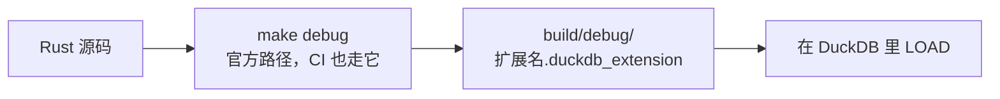

# 构建与发版

## 构建

构建走官方 DuckDB `extension-ci-tools` makefile，`just build` 把它包了一层：

```shell
make configure           # 只做一次：建 configure/venv（Python 与 sqllogictest 运行器）
make debug               # 官方路径，CI 也走它
# -> build/debug/duckfn_open.duckdb_extension
```

产物落在哪里、又是怎么加载的：



`just build` 跑的是 `make configure && make debug`。`make release` 是带优化的同一套流程。Windows 上 `make` 需要在 Git Bash 里跑。

## Justfile

| 命令 | 做什么 |
| --- | --- |
| `just build` | `make configure && make debug` |
| `just sql "SELECT op_open_path(NULL)"` | 先构建，再跑一条语句就退出 |
| `just repl` | 已 LOAD 扩展的 DuckDB REPL |
| `just lint` | `cargo clippy --all-targets -- -D warnings` |
| `just test` | 官方构建 + sqllogictest |
| `just docs_csv` | 把函数描述导出到 `target/function_descriptions.csv` |
| `just docs_build` / `just docs_start` | 构建 / 本地预览这份文档站 |
| `just rename <名字>` | 一次改齐扩展名 |
| `just release_*` | 下面那套发版流程 |
| `just build_wasm` / `build_wasm_eh` / `test_wasm` | 本项目的覆盖：只打印一句「本扩展不构建 wasm」（见下面「不构建 WebAssembly」一节） |
| `just sync-common` / `just check-common` | 更新 / 比对 `scripts/common.just`（见下） |

上面这些 recipe 都在 `scripts/common.just` 里 —— 那是所有扩展项目共享的一份文件，由根 `Justfile`
`import` 进来（`just --list` 看到的是合并后的全集）。它的源在 duckfn 仓库：`just sync-common` 拉回
最新副本，`just check-common` 在副本不一致时报错。本项目特有的命令写进根 `Justfile`，不要去改副本；
细节见 `AGENTS.md`。

wasm 那三条就是这么关掉的：共享副本里 `build_wasm`、`build_wasm_eh`、`test_wasm` 照旧定义着，根
`Justfile` 在 `set allow-duplicate-recipes := true` 下把它们重新声明成一条私有的 `no_wasm`。改副本不行 ——
下一次 `just sync-common` 就把改动冲掉了。

:::note[共享副本里两处对不上本项目的注释]

`just --list` 打印的是 `scripts/common.just` 自带的那些注释，其中两条还停在模板的 wasm 配置上：
`docs_build` / `docs_start` 说构建前要把扩展放进 `docs/static/duckdb-extensions/`，`config_env` 还会
`rustup target add wasm32-unknown-emscripten`。这两条在本项目都不成立 —— 站点没有可运行块，也就没有
任何要预加载的产物；`config_env` 里剩下那半件有用的事是 `rustup override set`。这些注释是刻意不改的。

:::

## 发版流程

一次发版四步，只有第二步需要人来做：

| 步骤 | 命令 |
| --- | --- |
| 0. 前置检查 | `just release_check`（clippy + 构建）；改动大时再 `just test` |
| 1. 提升版本号 | `just release_bump {{EXTENSION_VERSION}}` |
| 2. 提交并打 tag | `git commit …` 后 `just release_tag {{EXTENSION_VERSION}}` |
| 3. 看 CI | `just release_ci`，再 `gh run watch <run-id>` |
| 4. 切下一开发版本 | `just release_dev 0.1.1-dev.0` |

版本号只写在 `Cargo.toml` 的 `[package] version` 里，别处不写：`scripts/release.sh bump` 会改这一行、
更新文档与 CI 注释里的出现处、同步 `Cargo.lock`，并改写 `docs/extension-version.ts`（文档站显示的版本号
就是从那里来的）。tag 必须与 `Cargo.toml` 一致 —— cargo 会把版本号写进构建出的扩展二进制，对不上就会发出
一个自称别的版本的 Release。

只有正式版本才打 tag。`0.1.1-dev.0` 这类版本留在分支上：不打 tag、不发布、也不部署站点。

### 推一个 tag 会触发什么

推送 `v*.*.*` 会启动 **Main Extension Distribution Pipeline**：


- **Main Extension Distribution Pipeline** —— 为所有支持的桌面平台构建扩展、跑测试（wasm 那几台架构由
  工作流的 `exclude_archs` 输入排除，见下面「不构建 WebAssembly」一节），然后为该 tag 创建（或更新）
  GitHub Release，把产物按 `<扩展名>-<架构>.duckdb_extension` 挂上去。release notes 是上一个版本 tag
  到当前 tag 之间的提交。
- **Deploy Docs** 不是由 tag 启动的，而是由那条流水线**跑完**触发：它构建 `docs/` 并发布到 GitHub
  Pages。站点是一份纯静态产物 —— 它不从 Release 取任何东西（`sql` 围栏是代码块，不是能跑的示例）。
  需要先在 Settings → Pages → Source 里选 *GitHub Actions*，一次性设置。

PR 只构建 + 测试，不发布：发布那一步由「当前 ref 是版本 tag」这个条件把着。

### 安装一份发布产物

```sql
LOAD 'https://github.com/<owner>/<repo>/releases/latest/download/duckfn_open-windows_amd64.duckdb_extension';
```

本地构建的产物要 `duckdb -unsigned`；从 Release 下载的产物同样要加这个参数，因为它没有 DuckDB 分发密钥
的签名。这正是[社区扩展](./community-extension.md)那条路解决的问题：注册之后 `INSTALL … FROM community`
会按用户平台取回一份签过名、版本严格匹配的产物。

## 不构建 WebAssembly

这个项目不做 wasm 构建，这是有意的设计而不是漏配：启动器是桌面软件 —— 浏览器里没有桌面可以把文件交给它；
而 [`open`](https://crates.io/crates/open) 没有 emscripten 实现，在那个目标上直接 `compile_error!`，
wasm 构建连链接那一步都到不了。

排除是一次做到底的，每个落点都是刻意留下的：

| 落点 | 现状 |
| --- | --- |
| `Cargo.toml` | 没有 wasm 的 `[[example]]`（模板那份 `staticlib` 转发已删），`open` 是 `[dependencies]` 里普通的一项，没有 `[target.'cfg(…)'.dependencies]` 门控。 |
| `src/` | 只有一个 crate root `src/lib.rs`（模板里的 `src/wasm_lib.rs` 已删），`src/extension/launcher.rs` 里也没有 `#[cfg(target_arch = "wasm32")]` 替身。 |
| `.github/workflows/MainDistributionPipeline.yml` | `exclude_archs: 'wasm_mvp;wasm_eh;wasm_threads'`，Release 上只有原生平台的产物。 |
| `Justfile` | `build_wasm`、`build_wasm_eh`、`test_wasm` 被覆盖成打印一句说明；共享副本 `scripts/common.just` 保留原文，不去改它。 |
| `docs/` | 没有可运行 SQL 块：`sql` 围栏全是静态代码块，示例要读者在本地 DuckDB 里 `LOAD` 之后跑（见[快速开始](./quick-start.md)）。 |

要恢复 wasm 就得这五处一起做，不是拨一个开关 —— 所以新增依赖时不必为 wasm 目标考虑，也别再往 Cargo.toml
里补 `[[example]]` staticlib。

真要做 wasm 的项目，`.cargo/config.toml` 得在 `[target.wasm32-unknown-emscripten] rustflags` 里加
`-sSIDE_MODULE=2`（那个目标下的 `cdylib` 必须按 side module 链接）。本仓库里没有这一条，只有 Windows 的
`crt-static` —— 它没有 emscripten 目标要链接。
