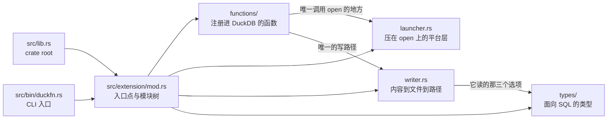

# 目录结构

```text
src/lib.rs             crate root  ->  mod extension;
src/extension/mod.rs   ->  duckfn_entrypoint!("duckfn_open");
                           mod functions; mod launcher; mod types; mod writer;
src/bin/duckfn.rs      duckfn CLI 入口  ->  #[path] mod extension; + duckfn::cli::run(...)

src/extension/functions/
    mod.rs                  下面每个文件一行 `mod …;`，按字母序（这份清单按族类排）
    scalar_op_open_path.rs     op_open_path / op_open_path_detached，各两个签名
    scalar_op_open_commands.rs op_open_commands（VARCHAR -> VARCHAR[]，不起任何进程）
    scalar_op_write_file.rs    op_write_file      四个签名，只落盘
    scalar_op_open_content.rs  op_open_content    四个签名，落盘接着打开
    scalar_op_open_html.rs     op_open_html       零配置的 HTML 快捷方式
    scalar_op_print.rs    op_print      两个签名，直接打 stdout
    scalar_op_sanitize_filename.rs op_sanitize_filename / op_sanitize_filename_check，五个签名，纯字符串
src/extension/launcher.rs   压在 open 这个 crate 之上的平台层（唯一调用它的文件）
src/extension/writer.rs     内容 -> 文件 -> 路径：后缀、目录、命名、合法性
src/extension/types/
    mod.rs                  面向 SQL 的类型层
    op_write_file_options.rs   注册进 DuckDB 的 STRUCT 类型 `op_write_file_options`

test/sql/                  duckfn_open.test（冒烟）+ 每个函数文件一份 .test
scripts/rename.sh           克隆后改扩展名
scripts/release.sh          提版本号、打 tag、切开发版本
Justfile                    日常命令
docs/                       这份文档站
community-extension/        社区扩展注册草稿
```

## 一个 crate root

`src/lib.rs` 只声明一个模块 `mod extension;`，其余四层的子模块都由 `extension/mod.rs` 往下挂：
`functions`、`launcher`、`types`、`writer`。官方 Rust 模板的写法是 `mod lib;` 再由第二个 crate root
转发一次，模块一嵌套就会 `error[E0583]: file not found for module …`：那等于同一组路径存了两份、
要一直保持同步。

两个入口编同一棵模块树 —— crate root 与那个 CLI：



所以新增模块只需要动 `extension/mod.rs`（以及下一层的 `mod.rs`），永远不用改 crate root。

## 每一层各管什么

`extension/` 下除了入口点，东西都归这四层，切分的依据是「改一件事要付多大代价」：

| 层 | 负责 | 刻意不碰 |
| --- | --- | --- |
| `functions/` | SQL 边界：校验入参、给错误加上函数名前缀、选定那一句 launcher / writer 调用 | 拼命令行，也决定不了文件名怎么来 |
| `launcher.rs` | 「起一个程序」这件事上所有与平台有关的部分 | 回过头去碰 duckfn 之外的 SQL 类型 |
| `writer.rs` | 内容 → 文件 → 路径：后缀、目录、自动命名、文件名合法性 | 起进程 |
| `types/` | 面向 SQL 的类型长什么样 | 做任何校验 |

于是一个名字要多一个参数、一个平台要多一个启动器、一条命名规则要多一个例外，各自只落在一处文件里。

`scalar_op_sanitize_filename.rs` 是 `functions/` 那一行的例外：它没有进程要起、也没有文件要写，SQL 边界就是
这件事的全部 —— 它自己直接调
[`sanitize-filename`](https://crates.io/crates/sanitize-filename)，把那个库的两个入口（改写、判断）原样
接到 SQL 上。所以它是下面那两层的**兄弟**，而不是任何一层的调用方
（见下文「纯字符串那一族」）。

## 平台层：`launcher.rs`

`extension/launcher.rs` 不是模板里的东西，是这个扩展加的一层，也是唯一碰
[`open`](https://crates.io/crates/open) 这个 crate 的文件。它的全部对外面就是七个函数，分三组：

1. 四个把 `io::Result<()>` 压成 `bool` 的动作（默认程序 / 指定程序 × 等 / 不等），这就是
   `op_open_path` 那一族的返回值；
2. `open_default_checked`，同一次不等的启动，只是把失败换成了错误 —— 下面细说；
3. `preview_commands`，把 open 会跑的 `Vec<Command>` 渲染成字符串列表，外加 `check_not_empty`，
   SQL 边界上要做的参数校验。

`open_default_checked` 之所以存在，是因为 `op_open_content` 与 `op_open_html` 的返回值已经花在写出来的路径上
了：启动失败在那里没有别的位置可去，只能报错，而且报文要带着那个路径（文件确实在磁盘上，只是这台机器
没有桌面能把它展示出来）。把它从「返回 bool」那一组里单分出来，守住的是一条规则 ——
启动器的结论要么进返回值、要么进错误，不会两边都占。

`check_not_empty` 是五个走启动器那条路的签名（`op_open_path` 四个 + `op_open_commands`）在 SQL 边界上做的校验，
写成一处而不是抄五遍，报文才始终一个样子。路径除了「不是空串」之外不再做更多检查：一个字符串到底是
可用的路径还是 URL，那是 open 的判断，这一层不替它重新决定。

为什么要单独一个模块、而不是在每个签名里各写一句调用：这样函数文件面对的是一个稳定的形状，而 open
已经承担的事（各平台入口、参数引用、WSL 与 Wine 的分支）只在这一处交代一次，不用每个调用点重新判断一遍。

于是：新函数要碰启动器就调 `launcher::…`，不要 `use open::`，SQL 那一层也就不需要任何平台分支代码 ——
这棵树里一个 `#[cfg]` 都没有：本扩展只构建桌面平台，见[构建与发版](./build-and-release.md)。

## 落盘层：`writer.rs`

启动器只认路径、不认内容，而查询里躺着的大多是内容：渲染好的 HTML 或 SVG、一份 CSV、BLOB 里的 PNG
字节。`writer.rs` 就是缺的那一步 —— 内容 → 文件 → 路径 —— 它只有一个入口：
`write(bytes, extension, options)`。

为什么它单独是一层、而不是某个函数文件里的小工具：`op_write_file`、`op_open_content`、`op_open_html` 走的都是同
一条 `writer::write`，所以下面这些规则只存在一份，三个名字一起生效；将来第四个要落盘的名字是白拿的。

这一层里有什么：

- **后缀** —— 必填，并且要归一（`html`、`.html`、` HTM ` 都变成 `.html`）。空后缀是错误，带路径分隔符的
  也是错误 —— 那多半是一条伪装成后缀的路径。
- **目录** —— 给了 `dir` 就用它，否则用系统临时目录；两种情况都连父级一起建出来。
- **名字** —— 给了 `name` 就用它（同名文件按覆盖处理），否则自动命名
  `open-<时间>-<part>-<随机尾缀>.<后缀>`。时间戳归 `chrono`，随机尾缀与「这个名字当时确实是空的」这个
  保证归 `tempfile`。
- **合法性** —— 用户能填的三个字段一律先过 `sanitize-filename`，所以一套规则同时管住目录、文件名与
  命名段。

拼路径用的是一段字面量 `/`（`join(dir, file_name)`），不是 `Path::join` —— 后者按平台分隔符拼。三个平台
上同一种形状，返回值才可用：它要打进终端看，通常还要被下游查询接着拼，测试则盯着
`__TEST_DIR__/name.ext` 这个形状断言。`std::fs` 在 Windows 上也接受 `/`，所以下游不必知道这件事。

这一层不起任何进程，也没有任何按目标平台的门控 —— 理由和平台层一样：只有桌面。

## 纯字符串那一族

`scalar_op_sanitize_filename.rs` 装着 `op_sanitize_filename`（三个签名）与 `op_sanitize_filename_check`（两个签名）。它挂在
`functions/` 底下，却**两层都不调**：不起进程、不写文件，`VARCHAR` 进去，出来的是一条 `VARCHAR` 或一个
`BOOLEAN`。它真正是的东西 —— 也正是让它成为那两层的兄弟、而不是调用方的那一点 —— 是
`sanitize-filename` 这个库自己的对外面，原样接到了 SQL 上。

这个库维护的是「一个字符串能不能当文件名」：非法字符 `/ \ ? < > : * | "`、控制字符、整段只是点的名字
（`.` 和 `..`）、Windows 保留的设备名（`CON`、`PRN`、`AUX`、`NUL`、`COM0-9`、`LPT0-9`，带后缀也算）、
结尾的点与空格，还有 255 **字节**这一刀。`op_sanitize_filename` 后面那三个参数就是库里 `Options` 的字段，缺省也
跟着库走 —— 所以非法字符是被**删掉**的（`replacement` 是空串；想看见改过的地方就给定一个替换符），那一刀
是开着的。

**只有一处缺省不跟库走：`windows` 钉死成 `true`。** 库里这一项的缺省是*编译时所在的那个平台*，那会让同一条
SQL 在两台机器上给出两个答案；`true` 是最严的一套，三个平台上同形。要 Unix 那套规则就给这一项传
`false` —— 在那套规则下 `op_sanitize_filename('CON.txt', '_', true, false)` 会把名字留着，而
`op_sanitize_filename_check('CON.txt')` 仍然是 `false`，因为那一句问的是 Windows。

它们**不是 `op_write_file` 的助手**，尽管落盘那一族内部用的就是同一个库 —— 策略并不一样：`op_write_file` 的
`name` 换成 `_`、从不截断，而 `op_sanitize_filename` 是删掉、并且截断。两套缺省各写各的文档，谁都不是另一个的
替身。这个决定就刻在 API 的形状上：`op_sanitize_filename` **没有三个参数的形式**，因为 `truncate` 与 `windows`
只能一起给 —— 这是这份 API 里唯一的一处压缩（两个 BOOLEAN 摆在可选位置上是五种组合，其中只有这个库自己
缺省的那两种值得再给一个更短的形式）；`op_sanitize_filename_check` 干脆没有 `replacement`，因为一个什么都不改写
的问题没有「换成什么」这一项。它回 `true` 的充要条件，是在同样的开关下 `op_sanitize_filename` 会把拿到的值原样
还回来 —— 正因如此 `WHERE NOT op_sanitize_filename_check(name)` 是一次体检，而不是一次悄悄改写。任何一个参数是
`NULL`，这一行就是 `NULL`。

还有一处刻意的**不给**：`op_write_file` 内部那条自动命名的 `part` 规则（空格并成 `_`、最长 48 个字符）没有
注册成 SQL 名字。那是本扩展自己的约定，不是那个库的规则，给它一个名字等于暗示调用方可以在写盘之外照着它
依赖。

## 面向 SQL 的类型：`types/`

`extension/types/` 放的是出现在 SQL 里、而不是出现在某个 Rust 调用里的类型。目前有一个：
`op_write_file_options`，承载 `op_write_file` / `op_open_content` 那三个可选项（`dir`、`name`、`part`）的 STRUCT：

```rust
#[derive(Clone, Debug, Default, DuckStruct)]
#[duck(sql_name = "op_write_file_options", create_type = "replace")]
pub(crate) struct OpenWriteOptions {
    pub dir: Option<String>,
    pub name: Option<String>,
    pub part: Option<String>,
}
```

这个形状在干三件事（字段级的两条见[编写函数](./writing-functions.md)）：

- 比三个同类型的可选位置参数好读，也比一段 JSON 好校验 —— 字段拼错在 binder 那一层就报错，不必等运行期；
- 它让这些名字不再扩散：选项是一个参数，所以 `op_write_file` 只有两种 arity，而不是四种；
- 它刻意**不含** `app` 字段。用哪个程序打开是 `op_open_path(path, app)` 的事，把路径交给它才是这套 API 的
  组合方式。

同样该放进这一层的还有：用 `#[duck_enum]` 注册的具名类型、`list<struct<…>>` 返回值的行类型、
`DuckLazy` 参数要解析的那个配置类型。可见性按「谁读它」放宽一档 —— 这里是 `pub(crate)`，因为
`functions` 子树要读它。

还有一样是刻意**不**放进来的：`op_sanitize_filename` / `op_sanitize_filename_check` 不注册任何类型，所以
`duckdb_types()` 里查不出新东西。它们的选项是两个只有成对才有意义的 BOOLEAN —— 那是一份参数列表，不是一个
值得注册成 SQL 类型的形状（见下文「纯字符串那一族」）。

## 命令行工具

`src/bin/duckfn.rs` 用 `#[path = "../extension/mod.rs"] mod extension;` 把扩展再编一遍，然后调用
`duckfn::cli::run(...)`。它存在的意义是导出函数描述 CSV（`just docs_csv`），不参与扩展本体。

那里的 `#[path]` 不是省事的写法，而是必需的：`#[duck_*]` 的文档元数据靠 `inventory` 的静态构造器收集，
只有**真正被链接进最终二进制**的目标文件才会生效。写成 `use duckfn_open::…` 时，链接器可能把这些模块
整块丢掉，导出的 CSV 就会静默变空。

## 每个函数一个文件，前缀即命名空间

`functions/` 下的文件名是「哪一类 + 做什么」：`scalar_op_open_path.rs` 装着两个启动器名字（四个签名，因为
每个名字各有 `(path)` 与 `(path, app)` 两个形式），`scalar_op_write_file.rs` 装着 `op_write_file` 的四个签名，
`scalar_op_open_commands.rs` 装着那个只读预览，`scalar_op_sanitize_filename.rs` 装着那两个纯字符串名字（五个签名），
两层都不碰。某个功能长大之后再像 duckfn 示例那样拆成子目录
（`functions/<功能>/mod.rs` + 各司其职的文件）。

每个注册进 SQL 的名字都带同一个短前缀（这里是 `op_`）；理由在 `AGENTS.md`：社区扩展几乎都不把包名
写进函数名，而短前缀足够在 `duckdb_functions()` 里检索。前缀是命名空间，不是扩展名的缩写，所以改扩展名
时它不跟着变。前缀之下还有一层：会起启动器的那几个带 `op_open_`（`op_open_commands` 也在内，因为它预览的
正是这些），其余的并不说「open」—— `op_write_file`、`op_print`、`op_sanitize_filename`。

## 依赖

`Cargo.toml` 里每个 crate 都写了一句它负责什么、为什么选它。决定构建形态的是这几个：

- **[duckfn](https://crates.io/crates/duckfn)** —— 把普通 Rust 函数注册进 DuckDB 的属性宏。只开了
  `cli` 这一个 feature（`src/bin/duckfn.rs` 要用）；刻意不开 `all`，因为它会一起打开 `duckdb-1-5`，
  也就是 DuckDB C API 的**不稳定区**（copy 函数、宿主 VFS、标量的 bind/init 槽位）。留在稳定区，
  才有一份二进制跨 DuckDB 版本通用。`chrono` / `uuid` / `rust_decimal` 这几个转换与 ABI 无关，需要时
  再开；`owned-connection`（它才打开宿主文件系统 `duckfn::duck_vfs`）属于不稳定区，用不到。
- **[quack-rs](https://crates.io/crates/quack-rs)** —— `duckfn_entrypoint!` 展开出的代码直接引用的
  DuckDB C API 绑定。
- **[libduckdb-sys](https://crates.io/crates/libduckdb-sys)** —— 只有头文件（`loadable-extension`），
  所以本地不需要编译 DuckDB。
- **[open](https://crates.io/crates/open)** —— 这个扩展「启动」的那一半：「按桌面配置好的程序把一个路径或
  URL 打开」这件事它已经做完了，各平台入口、参数引用、「启动器起不来」的错误都归它管。它就是
  `[dependencies]` 里普通的一项：本项目只构建桌面平台，所以没有目标门控要写
  （见[构建与发版](./build-and-release.md)），而且它只被 `src/extension/launcher.rs` 调用（就是上面那一层）。
  feature 开的是 `shellexecute-on-windows`（`_detached` 那一组与 `open_default_checked` 因此走一次
  `ShellExecuteW`）；不开 `insecure`，它把路径拼进命令行，正是要躲开的注入面。
- **[sanitize-filename](https://crates.io/crates/sanitize-filename)** —— 文件名的**合法性**：非法字符
  `/ \ ? < > : * | "`、控制字符、Windows 保留设备名（`CON`、`NUL`、`COM1`…）与结尾的点与空格。规则归它管，
  我们说的是策略，而这里有两**套**策略。`writer.rs` 换成 `_`、不截断（它按 255 **字节**截一刀，太宽松；长度
  这事由我们自己按字符数管），并且把 `windows: true` 写死，于是一套规则在三个平台都成立。
  `scalar_op_sanitize_filename.rs` 则是把这个库自己的对外面交给 SQL —— 缺省照库走（删掉而不是替换、那一刀开着），
  只有 `windows` 同样钉死；它明确**不是** `op_write_file` 的助手（见下文「纯字符串那一族」）。
- **[tempfile](https://crates.io/crates/tempfile)** —— 自动名字的随机尾缀、撞名时的重试，以及「这个名字当时
  确实是空的」这个保证；`writer.rs` 自己测试用的临时目录也是它的事。另一条路是「自己拼一个随机数再去
  `Path::exists` 轮询」，那会留下 TOCTOU 的窗口，随机源还得自己找。
- **[chrono](https://crates.io/crates/chrono)** —— 自动名字里那段 `%Y%m%d-%H%M%S` 时间戳。日历算术正是它的
  事，手算 epoch 不是。

后三个 crate 服务的是 `open` 那件事的另一半：启动器要的是路径，所以内容得有个地方变成路径。这正是仓库
的既定约定 —— 通用问题交给成熟的 crate，手写只留给这个扩展自己的领域逻辑（见 `AGENTS.md`
「尽量用成熟三方库实现，不要自己造轮子」）。

这里的 `chrono` 是纯 Rust 侧的用法（文件名里的时间戳），它不是 duckfn 的那个 `chrono` **feature**：那个
feature 管的是 `DuckDate` / `DuckTimestamp` 与 chrono 类型互转，而本扩展没有任何函数做这种转换。真加一个
的时候，把 feature 打开就行，crate 不用再引 —— 它已经是依赖了。真出现「只有部分目标编得过」的 crate 时，
`[target.'cfg(…)'.dependencies]` 仍然是对的工具 —— 只是这个项目没有第二套目标，所以用不上这一层。

## 这个扩展没用的东西

模板演示的是**注册路径**与**工程闭环**。这个扩展只注册标量函数和一个 STRUCT 类型，下面这些仍然不在
仓库里 —— 要写就从 duckfn 的文档与示例扩展里抄，不要凭记忆：

- 聚合函数（这里没有任何按组合并的东西：没有 `#[duck_aggregate_function]`，也没有状态类型）；
- 表函数 / `COPY` / cast / 替换扫描 / SQL 宏（各一个属性宏；见 duckfn 的 `docs/docs/guide/` 与它
  `src/extension/` 下的示例扩展）；
- 具名 ENUM 类型（`#[duck_enum]`）—— 和本扩展这个 STRUCT 一样的 `create_type` 思路，用在取值是一张标签表
  的类型上；
- `DuckLazy<T>` 参数（「配置只解析一次」）与 `list<struct<…>>` 返回值 —— 这里的选项 STRUCT 是按普通参数
  读的，而这个扩展返回的 list 就是一个普通的 `Vec<String>`；
- DuckDB 的宿主文件系统（`duckfn::duck_vfs`，要显式打开 `owned-connection`），以及 chrono / uuid /
  rust_decimal **桥**（chrono 本身是依赖，上面刚说过）。

模板里**没有**、而这个扩展加进去的三样可以当作现成的范式：`overloads_name`（把多个签名并到一个 SQL 名字
底下，见[编写函数](./writing-functions.md)）、`launcher.rs` 这一层平台代码（把一个第三方 crate 收在一个
形状后面，别让它类型渗进 SQL 文件），以及 `writer.rs` 这一层落盘代码（把一条写路径放在多个 SQL 名字后面）。

## 命名规则

| 规则 | 为什么 |
| --- | --- |
| 扩展名全小写、只含下划线，且五处一致。 | 它既是入口点符号，也是产物文件名；DuckDB 是按文件名去找符号的。`just rename` 负责写全这五处。 |
| 每个注册进 SQL 的名字共用一个短前缀（这里是 `op_`）。 | DuckDB 没有命名空间，而社区扩展几乎都不把包名写进函数名。约定见 `AGENTS.md`。 |
| 临时文件（脚本、数据、日志）放 `target/`。 | `target/` 已被 git 忽略，不会污染被跟踪的目录。 |
| 文本文件一律 LF。 | 仓库按 LF 入库，`.gitattributes` 的归一化依赖这一点。 |

## 开发笔记在哪

设计说明就在这份指南里：上面的模块结构、[写函数](./writing-functions.md)、[测试](./testing.md) 与
[构建与发布](./build-and-release.md)。同一套 API 在 SQL 那一侧的样子（每个名字答复什么、能跑的示例）在
用户指南的[函数](../user-guide/functions.md)。`AGENTS.md` 里是仓库的约定、发版流程，以及一份
「duckfn 自己的文档按主题在哪儿」的对照表 —— 属性宏能做的所有事都在那边，不在本仓库里。

duckfn 0.0.11 起，那份指南连同**可运行的示例扩展**与它的 SQLLogicTest 用例都随 crate 一起发布，
所以它们始终与 `Cargo.toml` 里的版本一致，也不需要 clone duckfn 的 git 仓库：

```shell
# 跑过一次构建之后：cargo 实际编译的那份源码
ls -d ~/.cargo/registry/src/*/duckfn-*/
```

| 那个目录下的路径 | 是什么 |
| --- | --- |
| `docs/docs/**` | 用户指南正文（英文），含每类注册方式各一章。 |
| `docs/i18n/zh-Hans/…/current/**` | 同一份指南的简体中文版。 |
| `src/extension/**` | 示例扩展：每类注册方式一个文件，外加自定义类型与一个组合示例。 |
| `test/sql/**` | 示例的 SQLLogicTest 用例，抄结构用。 |

指南也有渲染好的在线版本 [shijianjs.github.io/duckfn/zh-Hans](https://shijianjs.github.io/duckfn/zh-Hans/)，
但它可能比你的依赖新；registry 里那份才是本项目实际编译的代码。属性宏到底接受哪些参数、允许哪些返回
形状，还要再往下走一层，在同个 registry 目录下的 `duckfn-macro-<版本>/src/**` 里。
