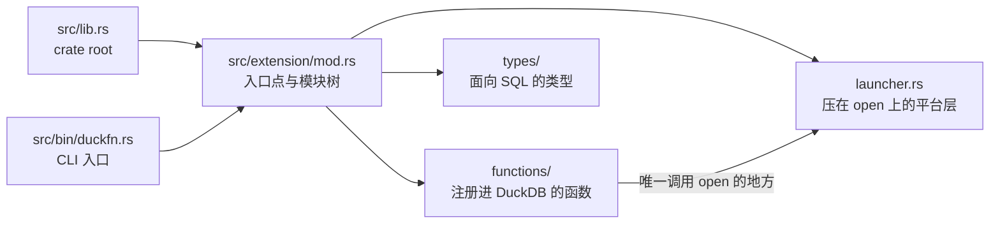

# 目录结构

```text
src/lib.rs             crate root  ->  mod extension;
src/extension/mod.rs   ->  duckfn_entrypoint!("duckfn_open"); + mod functions; mod launcher; mod types;
src/bin/duckfn.rs      duckfn CLI 入口  ->  #[path] mod extension; + duckfn::cli::run(...)

src/extension/functions/
    mod.rs             mod scalar_open_commands; mod scalar_open_path;
    scalar_open_path.rs     open_path / open_path_detached，各两个签名
    scalar_open_commands.rs open_commands（VARCHAR -> VARCHAR[]，不起任何进程）
src/extension/launcher.rs   压在 open 这个 crate 之上的平台层（唯一调用它的文件）
src/extension/types/
    mod.rs             空的槽：面向 SQL 的类型放这一层

test/sql/                  duckfn_open.test（冒烟）+ 每个函数文件一份 .test
scripts/rename.sh           克隆后改扩展名
scripts/release.sh          提版本号、打 tag、切开发版本
Justfile                    日常命令
docs/                       这份文档站
community-extension/        社区扩展注册草稿
```

## 一个 crate root

`src/lib.rs` 只声明一个模块 `mod extension;`，其余子模块由 `extension/mod.rs` 往下挂。官方 Rust 模板的
写法是 `mod lib;` 再由第二个 crate root 转发一次，模块一嵌套就会 `error[E0583]: file not found for
module …`：那等于同一组路径存了两份、要一直保持同步。

两个入口编同一棵模块树 —— crate root 与那个 CLI：



所以新增模块只需要动 `extension/mod.rs`（以及下一层的 `mod.rs`），永远不用改 crate root。

## 平台层：`launcher.rs`

`extension/launcher.rs` 不是模板里的东西，是这个扩展加的一层，也是唯一碰
[`open`](https://crates.io/crates/open) 这个 crate 的文件。它就两件事，每件都薄到一行：

1. 把 `io::Result<()>` 压成 `bool`，这就是 SQL 侧的返回值；
2. 把 `&str` 交给 open（它要的是 `OsStr` 加一个 app 名），并把它会跑的 `Vec<Command>` 渲染成字符串列表。

这层里还有 `check_not_empty`，五个签名在 SQL 边界上要做的那个空参数校验。

为什么要单独一个模块、而不是五个签名各写一遍调用：这样函数文件面对的是一个稳定的形状 —— 四个返回 bool
的动作加一个会报错的预览 —— 而 open 已经承担的事（各平台入口、参数引用、WSL 与 Wine 的分支）只在这一处
交代一次，不用每个调用点重新判断一遍。

于是：新函数要碰启动器就调 `launcher::…`，不要 `use open::`，SQL 那一层也就不需要任何平台分支代码 ——
这棵树里一个 `#[cfg]` 都没有：本扩展只构建桌面平台，见[构建与发版](./build-and-release.md)。

## 命令行工具

`src/bin/duckfn.rs` 用 `#[path = "../extension/mod.rs"] mod extension;` 把扩展再编一遍，然后调用
`duckfn::cli::run(...)`。它存在的意义是导出函数描述 CSV（`just docs_csv`），不参与扩展本体。

那里的 `#[path]` 不是省事的写法，而是必需的：`#[duck_*]` 的文档元数据靠 `inventory` 的静态构造器收集，
只有**真正被链接进最终二进制**的目标文件才会生效。写成 `use duckfn_open::…` 时，链接器可能把这些模块
整块丢掉，导出的 CSV 就会静默变空。

## 每个函数一个文件，前缀即命名空间

`functions/` 下的文件名是「哪一类 + 做什么」：`scalar_open_path.rs` 装着两个启动器名字（四个签名，因为
每个名字各有 `(path)` 与 `(path, app)` 两个形式），`scalar_open_commands.rs` 装着那个只读预览。某个功能
长大之后再像 duckfn 示例那样拆成子目录（`functions/<功能>/mod.rs` + 各司其职的文件）。

每个注册进 SQL 的名字都带同一个短前缀（这里是 `open_`）；理由在 `AGENTS.md`：社区扩展几乎都不把包名
写进函数名，而短前缀足够在 `duckdb_functions()` 里检索。

## `types/` 是留给你的槽位

这个扩展对 SQL 只说 `VARCHAR`、`BOOLEAN` 和 `VARCHAR[]`，用不到自定义类型，所以 `types/mod.rs` 里只有
注释。放进去的是三类东西：

- 用 `#[duck_struct]` / `#[duck_enum]` 定义、并在加载时注册进 DuckDB 的具名类型；
- `list<struct<...>>` 返回值的行类型（一个 derive `DuckStruct` 的普通 Rust struct）；
- `DuckLazy` 参数用的配置 STRUCT（在函数内部解析一次）。

永远用不上就整个目录删掉（连带 `extension/mod.rs` 里的 `mod types;`）。

## 依赖

`Cargo.toml` 里每个 crate 都写了一句它负责什么、为什么选它。决定构建形态的是这几个：

- **[duckfn](https://crates.io/crates/duckfn)** —— 把普通 Rust 函数注册进 DuckDB 的属性宏。只开了
  `cli` 这一个 feature（`src/bin/duckfn.rs` 要用）；刻意不开 `all`，因为它会一起打开 `duckdb-1-5`，
  也就是 DuckDB C API 的**不稳定区**（copy 函数、宿主 VFS、标量的 bind/init 槽位）。留在稳定区，
  才有一份二进制跨 DuckDB 版本通用。`chrono` / `uuid` / `rust_decimal` 这几个转换与 ABI 无关，需要时
  再开；`owned-connection`（它才打开宿主文件系统 `duckfn::duck_vfs`）属于不稳定区，用不到。
- **[quack-rs](https://crates.io/crates/quack-rs)** —— `duckfn_entrypoint!` 展开出的代码直接引用的
  DuckDB C API 绑定。
- **[libduckdb-sys](https://crates.io/crates/libduckdb-sys)** —— 只有头文件（`loadable-extension`），
  所以本地不需要编译 DuckDB。
- **[open](https://crates.io/crates/open)** —— 这个扩展包的就是它：「按桌面配置好的程序把一个路径或 URL
  打开」这件事它已经做完了，各平台入口、参数引用、「启动器起不来」的错误都归它管。它就是 `[dependencies]`
  里普通的一项：本项目只构建桌面平台，所以没有目标门控要写（见[构建与发版](./build-and-release.md)），
  而且它只被 `src/extension/launcher.rs` 调用（就是上面那一层）。feature 开的是
  `shellexecute-on-windows`（`_detached` 那组因此走一次 `ShellExecuteW`）；不开 `insecure`，它把路径拼进
  命令行，正是要躲开的注入面。

凡涉及日期时间的，开 duckfn 的 `chrono` feature 并把 `chrono` 加进来（duckfn 不 re-export 这些 crate）；
现成的两行就在 `Cargo.toml` 末尾。真出现「只有部分目标编得过」的 crate 时，
`[target.'cfg(…)'.dependencies]` 仍然是对的工具 —— 只是这个项目没有第二套目标，所以用不上这一层。

## 这个扩展没用的东西

模板演示的是**注册路径**与**工程闭环**。这个扩展只注册标量函数，下面这些仍然不在仓库里 —— 要写就从
duckfn 的文档与示例扩展里抄，不要凭记忆：

- 聚合函数（这里没有任何按组合并的东西：没有 `#[duck_aggregate_function]`，也没有状态类型）；
- 表函数 / `COPY` / cast / 替换扫描 / SQL 宏（各一个属性宏；见 duckfn 的 `docs/docs/guide/` 与它
  `src/extension/` 下的示例扩展）；
- `DuckLazy<T>` 参数（「配置只解析一次」）、具名类型、`list<struct>` 返回值 —— 这个扩展返回的 list 就是
  一个普通的 `Vec<String>`；
- DuckDB 的宿主文件系统（`duckfn::duck_vfs`，要显式打开 `owned-connection`），以及 chrono / uuid /
  rust_decimal 桥。

模板里**没有**、而这个扩展加进去的两样可以当作现成的范式：`overloads_name`（把每个启动器名字下的
`(path)` 与 `(path, app)` 并成一个函数集，见[编写函数](./writing-functions.md)），以及 `launcher.rs`
这一层平台代码本身（把一个第三方 crate 收在一个形状后面，别让它类型渗进 SQL 文件）。

## 命名规则

| 规则 | 为什么 |
| --- | --- |
| 扩展名全小写、只含下划线，且五处一致。 | 它既是入口点符号，也是产物文件名；DuckDB 是按文件名去找符号的。`just rename` 负责写全这五处。 |
| 每个注册进 SQL 的名字共用一个短前缀（这里是 `open_`）。 | DuckDB 没有命名空间，而社区扩展几乎都不把包名写进函数名。约定见 `AGENTS.md`。 |
| 临时文件（脚本、数据、日志）放 `target/`。 | `target/` 已被 git 忽略，不会污染被跟踪的目录。 |
| 文本文件一律 LF。 | 仓库按 LF 入库，`.gitattributes` 的归一化依赖这一点。 |

## 开发笔记在哪

设计说明就在这份指南里：上面的模块结构、[写函数](./writing-functions.md)、[测试](./testing.md) 与
[构建与发布](./build-and-release.md)。`AGENTS.md` 里是仓库的约定、发版流程，以及一份「duckfn 自己的
文档按主题在哪儿」的对照表 —— 属性宏能做的所有事都在那边，不在本仓库里。

duckfn 0.0.11 起，那份指南连同**可运行的示例扩展**与它的 SQLLogicTest 用例都随 crate 一起发布，
所以它们始终与 `Cargo.toml` 里的版本一致，也不需要 clone duckfn 的 git 仓库：

```shell
# 跑过一次构建之后：cargo 实际编译的那份源码
ls -d ~/.cargo/registry/src/*/duckfn-*/
```

| 那个目录下的路径 | 是什么 |
| --- | --- |
| `docs/docs/**` | 用户指南正文（英文），含每类注册方式各一章。 |
| `docs/i18n/zh-Hans/…/current/**` | 同一份指南的简体中文版。 |
| `src/extension/**` | 示例扩展：每类注册方式一个文件，外加自定义类型与一个组合示例。 |
| `test/sql/**` | 示例的 SQLLogicTest 用例，抄结构用。 |

指南也有渲染好的在线版本 [shijianjs.github.io/duckfn/zh-Hans](https://shijianjs.github.io/duckfn/zh-Hans/)，
但它可能比你的依赖新；registry 里那份才是本项目实际编译的代码。
