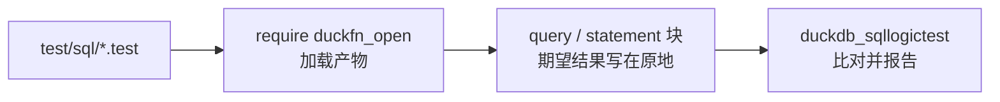

# 测试

测试用 [SQLLogicTest](https://duckdb.org/dev/sqllogictest/intro) 格式写在 `test/sql/` 下，与 DuckDB
自己的测试套件同一种格式。一个文件就是一串 `query` / `statement` 块，期望结果写在原地，所以用例同时也是
函数行为的可运行示例。

| 文件 | 覆盖什么 |
| --- | --- |
| `duckfn_open.test` | 冒烟：`LOAD` 之前这些名字不存在，`require` 之后三个 `open_` 名字都在（从 `duckdb_functions()` 里读，一次都不调用），`open_commands` 在本机真跑通，`SELECT open_path(NULL)` 是 `NULL`。它也是「扩展能被加载」的最小证明。 |
| `open_path.test` | 两个启动器名字作为函数集的样子：从目录里读出的注册形状（arity 1 与 2，返回 `BOOLEAN`）、常量 **和** 运行期的 `NULL` 都被短路（所以永远叫不起启动器）、四条空参数报错文案、参数个数/类型的 binder 报错，外加一条「Rust 那边的分支名（`open_path_with`、`open_path_detached_with`）没有多注册成 SQL 函数」的断言。 |
| `open_commands.test` | 只读那条路，也是在哪台机器上都能真跑的一段：`VARCHAR[]` 返回类型、候选序列非空、至少有一个候选把路径带在参数里、两处 `NULL` 短路、空路径报错、binder 报错，以及跨多个 DataChunk 的 3000 行。 |

这些文件围着一条规则写：**只断言没有桌面也答得出的东西。** `open_path('report.html')` 是不是回 `true`，
取决于这台机器装了哪些启动器、`.html` 关联到了谁 —— 而 CI 的 runner 恰恰两样都没有，那里每个动作只能回
`false`。所以启动器那组名字是靠目录、靠 `NULL`、靠报错文案、靠 binder 拦下什么来验的；唯一真按行算出
结果的函数是 `open_commands`，因为它不起进程。

## 怎么跑

一个文件是怎么走到运行器的：



```shell
just test                 # = make configure + make debug + make test
just ci-build             # 只做官方构建，不跑测试
```

`just test` 走 DuckDB 官方的 Makefile 流程，CI 也是这条。两件要知道的事：

- **它不会自动重新构建。** 改完 Rust 先跑 `just ci-build`（或 `make debug`），否则测试跑的是上一次的
  产物。
- **Windows 上 `make` 必须在 Git Bash 里跑**，PowerShell 里跑不起来。

### 更快的迭代

DuckDB 的测试运行器可以直接驱动产物，完全跳过 `make`。它需要一个装了 `duckdb_sqllogictest` 的 Python
环境 —— `make configure` 会在 `configure/venv` 下建一个，你也可以用任何装了这个包的 Python 3 环境：

```bash
# Linux / macOS
./configure/venv/bin/python -m duckdb_sqllogictest \
    --test-dir test/sql \
    --external-extension build/debug/duckfn_open.duckdb_extension
```

```powershell
# Windows
.\configure\venv\Scripts\python.exe -m duckdb_sqllogictest `
    --test-dir test/sql `
    --external-extension build/debug/duckfn_open.duckdb_extension
```

`--test-dir` 必给：它同时是 `__TEST_DIR__` 的取值，也就是会落盘写文件的用例拿到的目录。只跑一份就再加
`--file-path test/sql/open_path.test`。

## 约定

- **每个文件都从干净的数据库开始**，所以 `duckfn_open.test` 可以断言加载前这些名字不存在，其余文件开头写
  `require duckfn_open`。
- **错误是子串匹配。** `statement error` 下面写有辨识度的那一段就够了，不必抄 DuckDB 整条错误消息 ——
  抄全了反而会把用例绑死在一个随时可能改的文案上。`launcher::check_not_empty` 报的是本仓库自己的文案，
  所以整句写全（`open_path: the path or URL must not be empty`）。
- **用例不许起进程。** 这里没有任何一条断言依赖真实的 launch：注册形状来自 `duckdb_functions()`，唯一被
  真调用着算结果的，是设计上不起进程的 `open_commands`。
- **留意值怎么打印。** `DOUBLE` 打印成 `7.0`；用例关心的是数字而不是类型时，转一下
  （`SUM(x)::DECIMAL(10,1)`），这样类型变了期望值也不用改。
- **按目录里的名字检索时小心 `LIKE`。** 它的 `_` 匹配任意单个字符，`function_name LIKE '%_with%'` 会连
  你根本没想包括的名字一起命中；函数集那份用例因此用 `IN (…)` 逐个点名。
- **按关注点拆文件**，不要按函数个数：行为一份、错误路径一份；用到社区扩展（比如解析 HTML）的用例单独
  放，因为它首次运行需要网络。

## 新增函数至少覆盖什么

正常值、`NULL`、边界值、错误路径。另外三条很值：

- 文件是冒烟测试的话，加一条 `LOAD` 之前的 `statement error` … `does not exist`；
- 一条 **不是常量折叠** 的 NULL 输入 —— 常量 `NULL` 根本不会进函数体，而这种行恰恰是「真会去叫启动器」
  的那一种，所以值得断言它一次都没叫；
- 行数超过 `STANDARD_VECTOR_SIZE`（2048）的用例 —— 聚合的 `combine`、标量的逐 chunk 路径都靠它才跑到
  （`open_commands.test` 用 `range(3000)` 跑的就是后者）。

要跟操作系统打交道的函数，还要覆盖目录里怎么说它：这个 SQL 名字下的每一个 arity 与返回类型，以及 Rust
那一侧的名字没有多注册出一个函数。

提交前：`just lint`（`cargo clippy --all-targets -- -D warnings`）。
